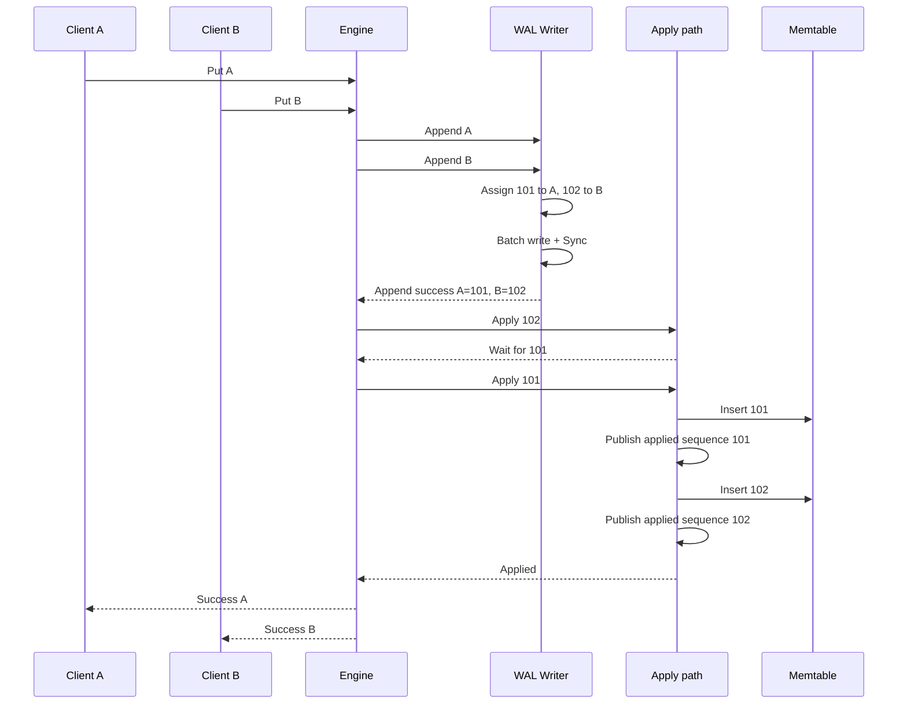
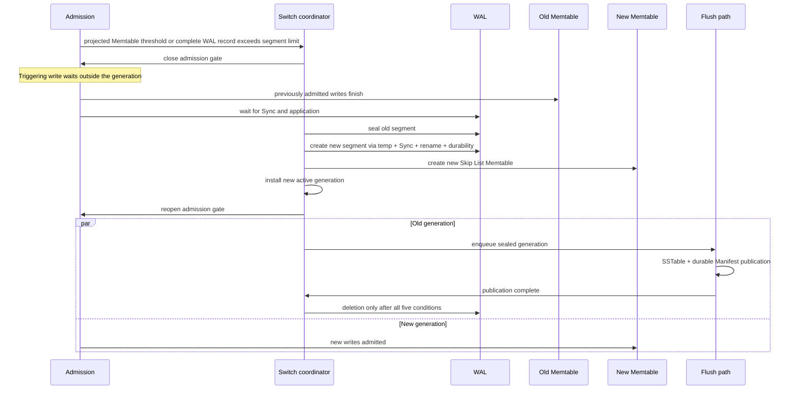
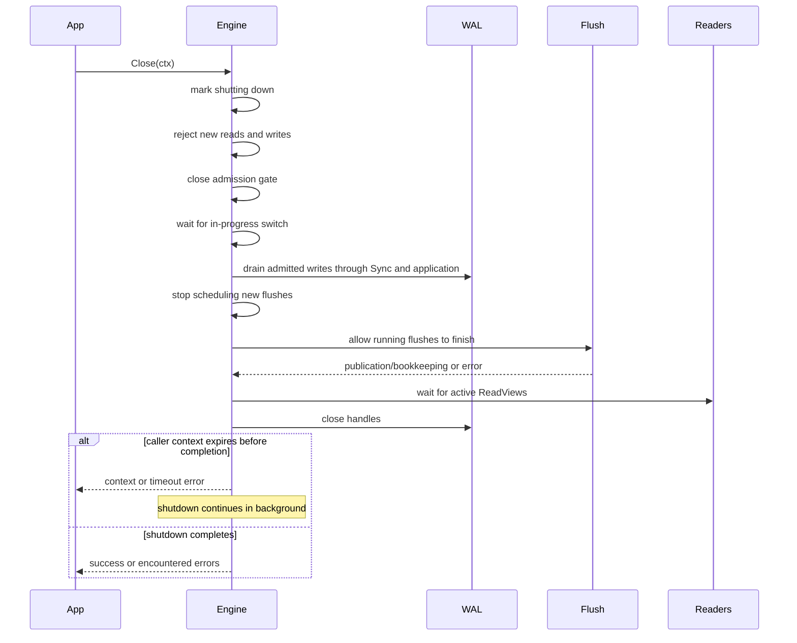

# Concurrency and Lifecycle

> **Status:** Finalized admission, ordered application, generation switching,
> ReadView semantics, fail-stop behavior and the 12-step caller-context shutdown
> sequence. ReadView synchronization is finalized as a short-held `sync.RWMutex`
> plus ReadView-level reference counting (D-083). Other internal primitives remain
> implementation choices.
>
> Automatic generation switching has exactly the two pre-admission triggers in
> D-081. Shutdown is caller-context controlled under D-082; context expiry never
> forces resource closure.

## 1. Purpose

This document describes how concurrent writes, WAL group commit, Memtable
application, generation switching, readers, flush publication and shutdown
interact. It defines required semantics, not a concrete Go implementation.

## 2. Concurrency model

| Participant | May run concurrently? | Ownership |
|---|---|---|
| Client calls | Yes | Pre-admission cancellation only |
| Engine admission | Serialized at the gate and switch boundary | Generation membership and reservations |
| WAL Writer | One dedicated writer goroutine | WAL writes, Sync, sequence assignment |
| Memtable apply path | Ordered by sequence; effectively serialized | Mutable Memtable |
| Readers | Yes | ReadView references acquired under `RLock` |
| Flush workers | May overlap with new-generation writes | Immutable Memtable |
| Manifest publisher | Serialized | Authoritative metadata |
| Cleanup | Coordinated with publication and retention | Obsolete resources |

The exact use of channels, condition variables, atomics or reader epochs is an
implementation choice, except for the ReadView publication lock and reference
counting required in §6 and the ordering rules below. The ordering and lifetime
rules are not optional.

## 3. Sequence assignment

The WAL Writer is the sole sequence assigner:

```text
admit request -> assign sequence -> enqueue -> batch -> write -> Sync
```

- WAL queue order, WAL byte order and sequence order are identical.
- A request rejected before admission does not consume a sequence.
- A failed batch may leave assigned sequences that never become durable. After
  recovery the next sequence is derived from recovered records and the durable
  watermark, so an unacknowledged lost sequence may be reused.
- No other component allocates a WAL sequence.

## 4. Ordered application and acknowledgement

The Engine applies records in ascending sequence order even when WAL completions
are observed out of order.



Rules:

- A record is applied only when all lower admitted sequences are applied.
- A higher sequence is never applied past an unresolved lower sequence.
- The Memtable entry is made visible before the corresponding applied-sequence
  value is published. A reader that captures sequence `S` must be able to see
  every entry at or below `S`.
- Client success requires successful WAL `Sync` and successful Memtable
  application.
- WAL batch completion does not authorize a client response by itself.
- Memtable application failure is Engine fail-stop. Do not skip the sequence or
  apply later sequences.

## 5. Admission, reservations and switching

### 5.1 Reservation

Before a write is admitted to the active generation, the Engine checks both
automatic switching triggers:

1. **Memtable threshold.** If `ActualUsage + ReservedBytes + NewReservation`
   reaches or exceeds the configured switching threshold, switch before
   admission and admit the waiting write into the new generation.
2. **WAL segment limit.** If appending the complete encoded WAL record would
   exceed the active segment’s configured size limit, switch before admission and
   admit the waiting write into the new generation’s WAL.

These are the only automatic triggers. An empty Memtable, startup, shutdown,
flush completion and timers do not trigger a switch on their own.

The same pre-admission step reserves the write’s conservative estimated memory
under the admission lock:

```text
ActualUsage + ReservedBytes + NewReservation <= HardLimit
```

The estimate covers key, value, entry/object overhead, Skip List node overhead,
associated allocations and a safety margin. It is not a full-Memtable scan.
After application the reservation converts to actual usage; before application a
failed write releases it. The estimator and safety margin require calibration;
see AQ-004 in [OPEN_QUESTIONS.md](OPEN_QUESTIONS.md).

If capacity cannot be reserved, admission waits for a switch or flush to release
capacity, or the caller’s pre-admission context is cancelled. A request larger
than the hard limit is rejected explicitly. A record that cannot fit within a
fresh configured WAL segment is rejected explicitly rather than switching
repeatedly. The hard limit is never exceeded.

### 5.2 Switch protocol

Admission is briefly closed during a switch.



Numbered protocol:

1. A candidate write triggers one of the two pre-admission conditions in §5.1.
2. Acquire switch coordination.
3. Close admission for new writes.
4. Previously admitted writes remain assigned to the old generation.
5. Wait for all previously admitted writes to finish WAL `Sync` and Memtable
   application.
6. Seal the old WAL segment.
7. Create the new WAL segment using the approved creation protocol.
8. Create a new Skip List Memtable.
9. Switch the active generation and install it in the ReadView state.
10. Reopen admission.
11. The waiting triggering write and later new writes are assigned to the new
    generation.

Closing the gate does not cancel admitted writes. A generation cannot be sealed
until every write admitted into it has succeeded or the Engine has entered a
failure state.

The old immutable Memtable flushes independently of new-generation writes.
Flush publication is serialized in generation/seal order so `FlushedThroughSeq`
remains a contiguous prefix. A later generation must not publish before an older
unflushed generation.

WAL rotation and Memtable switching happen together. The complete-record segment
limit and the projected Memtable threshold are the only automatic triggers for
this protocol, and both are evaluated before admission. The WAL does not rotate
independently. Empty Memtables, startup, shutdown, flush completion and timers do
not trigger a switch.

## 6. ReadViews

A ReadView is the unit of point-in-time read consistency. It is not a persistent
snapshot subsystem and does not copy Memtable data. A published ReadView holds an
ownership reference over every resource captured by that view.

### 6.1 Captured state

Each ReadView captures one consistent state:

- one `read_sequence`: the highest sequence whose entries are all visible;
- one consistent active/immutable Memtable set;
- one immutable published-SSTable metadata view.

The ReadView retains ownership of all captured Memtables, SSTable metadata and
associated file handles or resource references needed by readers using it.
Readers reference the ReadView, not individual Memtables or SSTables.

### 6.2 Acquisition and publication coordination

The publication lock is a short-held `sync.RWMutex`.

Required reader protocol:

1. Acquire `RLock` on the publication lock.
2. Capture the currently published ReadView.
3. Increment the captured ReadView’s reference count while still holding `RLock`.
4. Release `RLock`.
5. Perform the entire read using the captured ReadView.
6. Release the ReadView reference exactly once when the read operation finishes,
   regardless of whether the key was found, was not found, or an error occurred.

A key found in an earlier lookup layer does not permit early release. A naive
atomic-pointer load followed by an unsynchronized reference increment is
forbidden.

Required publisher protocol:

1. Construct a complete new immutable ReadView.
2. Acquire the write lock.
3. Install the new ReadView as the current published view.
4. Release the old published ReadView’s ownership reference.
5. Release the write lock.
6. Reclaim the old view and its captured resources only when its reference count
   reaches zero.

Switching and flush publication update the Memtable set and published-SSTable
view under this same publication lock. A reader therefore sees one of:

- the old complete ReadView with old Memtables and old published metadata; or
- the new complete ReadView with new Memtables and new published metadata.

It cannot see old Memtables with new SSTable metadata in a way that omits a
source, nor new metadata while still depending on a reclaimed Memtable or deleted
SSTable file.

Flush publication performs this sequence:

1. Durable Manifest publication completes.
2. Construct the complete new immutable ReadView.
3. Under the write lock, install it as the current published view.
4. Release the old published view’s ownership reference.
5. Release the write lock.
6. Readers that captured the old ReadView keep their references and finish
   safely; readers acquiring after the swap get the new ReadView.

A reader acquiring after the swap gets a `read_sequence` that is at least the
flushed table’s maximum sequence, because all its records were applied before the
flush. A reader acquiring before the swap keeps the old Memtables and old view.

Memtable and SSTable resources are reclaimed only when the last ReadView that
captured them reaches reference count zero. They are never reclaimed while the
published-view ownership reference or any reader reference exists.

### 6.3 Lookup and version visibility

Lookup order:

1. active Memtable;
2. immutable Memtables, newest to oldest;
3. published SSTables, newest to oldest, respecting level order. Phase 1 has only
   level 0, so descending publication/sequence order applies.

Within each source, find the newest entry for the key with
`sequence <= read_sequence`. Ignore entries above the captured sequence. A
tombstone at that version means “not found”; older values must not reappear.

If a source contains only versions newer than `read_sequence` for the key, continue
searching the same source for an older eligible version, then move to the next
source. The first eligible version in lookup order is authoritative.

### 6.4 Release and cleanup

- Each reader releases its ReadView reference exactly once on every exit path.
- A key found in an earlier layer does not shorten the reference lifetime.
- The ReadView releases its ownership of all captured Memtables, SSTable metadata
  and resource references when its reference count reaches zero.
- Cleanup may delete an SSTable only when no ReadView that can reference it
  remains.
- A reader must never observe a reclaimed Memtable or a deleted SSTable file.
- No per-Memtable or per-SSTable reader reference counting is used in Phase 1.

## 7. Flush concurrency

The old immutable Memtable may flush while new writes continue.

Flush path:

1. build the SSTable in sorted key order;
2. write, sync and fully validate it;
3. close, atomically rename and make the filename directory-durable;
4. durably publish the Manifest update;
5. construct and install the new immutable ReadView and release the old view’s
   ownership reference;
6. consider WAL deletion only when all five conditions hold.

A valid SSTable is not enough to complete a flush. A failed Manifest publication
leaves the SSTable, immutable Memtable and WAL retained. A flush failure is not
automatically an Engine corruption failure; the data remains recoverable from
WAL, but the engine must not claim the flush succeeded.

## 8. Failure states

### 8.1 WAL Failed

Triggered by any WAL write or `Sync` failure.

- reject new writes;
- fail affected in-flight and queued requests;
- do not retry, seek, truncate or continue in place;
- do not assume which bytes are durable;
- require close/reopen and recovery.

A cleanup deletion failure for an obsolete segment is not a WAL writer failure.
Retain the segment and retry cleanup later.

### 8.2 Engine Failed

Triggered by Memtable application failure after WAL `Sync`, estimator/accounting
invariant violation, or another fail-stop condition.

- reject new writes;
- reject new reads with a consistent Engine-failed error;
- fail affected in-flight requests;
- do not skip the failed sequence or apply later sequences;
- do not attempt in-place repair;
- require close/reopen and recovery.

In-flight reads check the failure state before completing. If failure is detected,
the read returns an error rather than a potentially inconsistent result. Each
in-flight read releases its ReadView reference exactly once, whether it completes
normally, returns an error, or observes failure. A read that completes without
detecting failure may return its consistent captured view.

A flush failure does not change the committed state and does not by itself make
the Engine Failed. If flush progress is impossible, the Engine must stop
admitting writes and report the condition rather than claim success.

## 9. Liveness constraints

- No lock or queue wait may prevent the WAL Writer from completing the batch it
  owns, including its file writes and `Sync`.
- Admission must not remain closed indefinitely while waiting for readers.
- Shutdown, switching and flush must not deadlock each other.
- The WAL Writer must progress without waiting for a client that stopped reading
  its response.
- A failed component is not revived by retrying an unsafe operation; reopen and
  recover.
- The switch coordinator, Manifest publisher and ReadView publication lock must
  use a consistent lock order. The concrete order is an implementation choice.

## 10. Graceful shutdown

Shutdown is caller-context controlled, conceptually:

```text
Close(ctx context.Context) error
```

The exact public API naming may be finalized during implementation. The 12-step
shutdown sequence is final:

1. Mark the Engine as shutting down.
2. Reject new writes and reads.
3. Close the write admission gate.
4. Wait for an in-progress generation switch to finish.
5. Wait for previously admitted writes to finish WAL `Sync` and Memtable
   application.
6. Stop scheduling new flushes.
7. Allow already-running flushes to finish.
8. Complete Manifest publication and bookkeeping for successful flushes.
9. If a flush fails, retain its WAL and Memtable data and report the error.
10. Wait for active readers to release their ReadViews.
11. Close WAL and SSTable file handles.
12. Return shutdown errors.



Rules:

- `Close` initiates graceful shutdown. It does not create a second shutdown
  path.
- Context expiry stops only the caller’s wait. It does not cancel the shutdown
  process, which continues in the background.
- Resources are never forcibly closed while a background operation still owns
  them because the caller’s context expired.
- A subsequent `Close` call may wait for the same shutdown operation to finish.
- Successful closure is never reported while background operations still own
  resources.
- If an operation fails during shutdown, the error is reported and the
  established durability and recovery guarantees are preserved.
- Shutdown does not need to force-flush every remaining Memtable. Unflushed
  writes remain recoverable through WAL replay.
- A write is never acknowledged unless WAL `Sync` and Memtable application both
  succeeded.
- A failed WAL write, `Sync`, Memtable application or flush is reported; shutdown
  must not claim that all accepted writes completed successfully.
- WAL and SSTable handles are not closed while an admitted write or active reader
  still depends on them.
- Shutdown never deletes WAL or SSTable data that a retained Manifest requires.
- Shutdown does not independently trigger a generation switch. It waits for an
  in-progress switch to finish.

## 11. Invariants

1. WAL sequence order is authoritative.
2. Memtable application is ascending by sequence.
3. An entry is visible before its applied-sequence value is published.
4. Client success requires WAL `Sync` and application.
5. A reservation is acquired before admission and protects the admitted write.
6. The Memtable hard maximum is never exceeded.
7. One WAL segment belongs to one generation.
8. A generation is sealed only after admitted writes finish.
9. Closing admission does not cancel admitted writes.
10. A published ReadView owns one `read_sequence`, one consistent active and
    immutable Memtable set, and one immutable published-SSTable metadata view.
11. A reader acquires its ReadView reference while holding `RLock` and releases it
    exactly once on every exit path.
12. A publisher constructs a complete new ReadView, installs it under the write
    lock, and releases the old view’s ownership reference. Reclamation occurs only
    when the ReadView reference count reaches zero.
13. A reader never observes an inconsistent mix of old and new publication state.
14. A reader never observes a reclaimed Memtable or deleted SSTable file.
15. A read never returns a version newer than its captured sequence.
16. Durable publication precedes ReadView installation, Engine Memtable release
    and WAL deletion.
17. Flush publication is serialized in generation/seal order.
18. Automatic generation switching has exactly two pre-admission triggers: the
    projected Memtable threshold and the complete next record exceeding the WAL
    segment limit. No other automatic trigger exists.
19. WAL write/sync failure is fail-stop.
20. Memtable application failure is Engine fail-stop.
21. Engine Failed rejects new reads and writes; in-flight reads error when failure
    is detected and always release their ReadView reference exactly once.
22. Shutdown reports failures and never claims uncompleted writes succeeded.
23. Context expiry stops only the caller’s wait. Shutdown continues in the
    background, never forces resource closure, and a later `Close` may wait for
    the same shutdown.
24. Shutdown does not independently trigger generation switching.
25. An empty generation is valid, produces no SSTable and introduces no special
    WAL deletion rule.

## 12. Related documents

- [SYSTEM_ARCHITECTURE.md](SYSTEM_ARCHITECTURE.md)
- [WAL_DESIGN.md](WAL_DESIGN.md)
- [MEMTABLE_DESIGN.md](MEMTABLE_DESIGN.md)
- [SSTABLE_DESIGN.md](SSTABLE_DESIGN.md)
- [MANIFEST_DESIGN.md](MANIFEST_DESIGN.md)
- [RECOVERY_AND_DURABILITY.md](RECOVERY_AND_DURABILITY.md)
- [FAILURE_SCENARIOS.md](FAILURE_SCENARIOS.md)
- [OPEN_QUESTIONS.md](OPEN_QUESTIONS.md)
