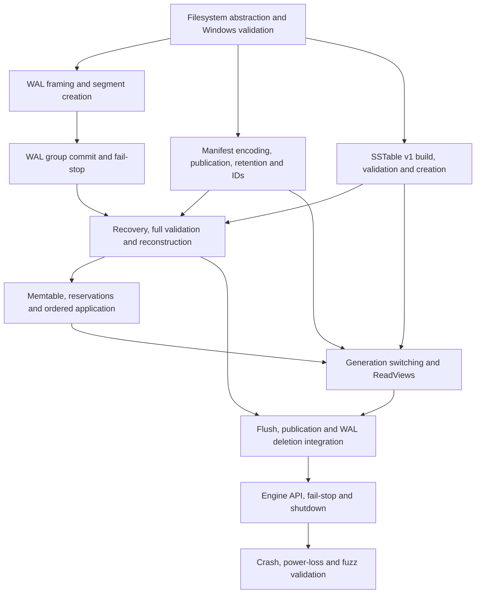

# Implementation Plan

> **Planning document only.** This plan sequences future Phase 1 work. It does
> not authorize implementation, contain Go code, or define internal code structure
> beyond the approved ReadView publication lock and reference-counting contract.
> No source, dependency, configuration or build file is created by the
> architecture documentation task.

## 1. Purpose

This plan sequences Phase 1 work after the finalized architecture. It identifies
dependencies, validation gates, implementation milestones and required tests.

The durability and metadata layers come first. The Engine is integrated only
after WAL, Manifest, SSTable and recovery behavior are independently
established.

## 2. Gate 0 — Final architecture and platform validation

The architecture review has finalized the formats and protocols. No format and no
open architectural policy remains. Before or during early implementation, the
following validation items must be resolved or explicitly accepted:

1. **Windows directory-entry durability mechanism.** Establish a mechanism for
   local NTFS and validate it; do not assume Linux directory `fsync` semantics.
   See AQ-003 in [OPEN_QUESTIONS.md](OPEN_QUESTIONS.md).
2. **Memory estimator calibration.** AQ-004. The accounting formula, safety
   margin and both pre-admission switching triggers are final; the estimator
   still requires calibration against the actual Go implementation.
3. **ReadView validation.** The `sync.RWMutex` plus ReadView-level reference
   counting design is final (D-083). Reference-count synchronization, resource
   lifetime, applied-sequence visibility, reader-lifetime tests, race/stress
   tests and leak checks must still be executed.
4. **Crash and power-loss verification plan.** AQ-006.

Items 1 and 4 are platform validation gates. They must not be reported as
complete merely because the logical protocol is documented. AQ-001 and AQ-002 are
resolved by D-081 and D-082 and are not implementation gates.

## 3. Milestones

### Milestone 1 — Filesystem abstraction and Windows backend

Scope:

- exclusive temporary-file creation;
- write and file Sync;
- atomic same-volume rename;
- non-overwriting rename for SSTable and Manifest publication;
- directory-entry durability after creation/rename;
- deletion and directory-entry durability after deletion;
- honest unsupported-operation errors;
- detection/qualification of local NTFS versus unsupported filesystems.

Testing:

- file Sync durability across process, crash and power loss where feasible;
- rename atomicity and non-overwrite behavior;
- directory entry persistence after create, rename and delete;
- reboot and abrupt power-loss matrix on local NTFS;
- unsupported filesystem behavior returns errors, never silent success.

Exit criteria:

- a validated Windows mechanism exists, or the limitation is explicitly
  recorded and Phase 1 support for that configuration is withheld;
- the abstraction exposes every operation needed by WAL, SSTable and Manifest
  publication;
- no component calls platform file APIs directly.

### Milestone 2 — WAL framing and segment creation

Dependencies: Milestone 1.

Scope:

- 20-byte segment header and header CRC;
- 28-byte-overhead record framing;
- Put/Delete types, flags, reserved fields and length validation;
- CRC32C Castagnoli;
- 16 MiB record and 1 MiB key limits;
- `wal-%020d.wal` naming and temporary creation;
- header Sync, non-overwriting rename, directory-entry durability;
- single-writer ownership and state model.

Testing:

- byte-level framing and boundary tests;
- malformed version/type/flags/reserved/length cases;
- overflow and allocation-before-validation cases;
- segment creation crash windows;
- Windows rename and directory-durability tests.

Exit criteria:

- the on-disk WAL format precisely matches [WAL_DESIGN.md](WAL_DESIGN.md);
- no writes are accepted into an unestablished segment;
- invalid records are rejected deterministically.

### Milestone 3 — WAL group commit and fail-stop

Dependencies: Milestone 2.

Scope:

- bounded queue of 4,096 requests;
- 200-microsecond collection interval;
- 1,024-record batch limit and 1 MiB batch byte target, with a larger single
  record forming its own batch up to 16 MiB;
- one write followed by one Sync;
- completion of all requests after successful Sync;
- requests arriving during write/Sync go to the next batch;
- cancellation only before enqueue;
- fail-stop on write/Sync failure;
- cleanup deletion failure does not poison the writer.

Testing:

- timer versus batch-limit boundaries;
- one Sync per batch;
- in-flight and queued failure propagation;
- no acknowledgement after Sync failure;
- queue backpressure and oversized-record rejection;
- stress and race tests.

Exit criteria:

- Sync is the only WAL durability boundary;
- a failed or uncertain Sync stops normal writes;
- no in-place retry, seek or truncation after failure.

### Milestone 4 — Manifest encoding, publication, retention and IDs

Dependencies: Milestone 1 and SSTable metadata definition.

Scope:

- canonical compact JSON schema with exact field order;
- CRC32C payload trailer;
- `MANIFEST-%020d` naming and temporary files;
- no `CURRENT` file;
- non-overwriting publication;
- three-version retention after cleanup with transient fourth;
- highest-valid-version fallback;
- SSTable ID scan and `NextSSTableID` allocation;
- conflicting-metadata rejection.

Testing:

- byte-exact canonical serialization and checksum coverage;
- malformed JSON, duplicate fields, non-canonical numbers, bad trailer;
- publication crash windows;
- four-version recovery;
- newest corruption and fallback;
- conflicting ID metadata;
- ID scan including final, temp, orphan and malformed names;
- ID exhaustion behavior.

Exit criteria:

- independent readers compute the same checksum over the same payload;
- no Manifest is overwritten;
- three committed versions remain after cleanup, with transient fourth tolerated;
- no observed SSTable ID is reused.

### Milestone 5 — SSTable v1 build, validation and durable creation

Dependencies: Milestone 1 and Memtable iteration format.

Scope:

- 36-byte header;
- 4 KiB target data blocks with block framing and CRC;
- entry encoding and ordering;
- sparse index;
- 68-byte metadata prefix plus key bounds;
- 40-byte footer;
- whole-file CRC32C in Manifest;
- temporary file, write, Sync, read-back full validation, close,
  non-overwriting rename and directory-entry durability;
- orphan retention.

Testing:

- exact byte layout and offset semantics;
- sortedness, key splitting prohibition and index correctness;
- every block CRC and whole-file CRC corruption;
- footer/index/metadata bounds and overlap cases;
- creation crash points;
- rename failure and directory-durability failure;
- orphan not adopted or visible.

Exit criteria:

- every byte of the format is implementable from
  [SSTABLE_DESIGN.md](SSTABLE_DESIGN.md);
- no Manifest references an unvalidated or unconfirmed file;
- a valid file is not treated as published.

### Milestone 6 — Recovery hierarchy, full validation and reconstruction

Dependencies: Milestones 2–5.

Scope:

- Manifest fallback across every available version;
- full SSTable validation including every data block;
- WAL enumeration, header/record validation and sequence checks;
- incomplete-tail truncation only in the newest segment;
- watermark straddling failure;
- missing-segment rules;
- reconstruction completeness predicate;
- fresh Manifest publication after reconstruction;
- fail-safe preservation of files;
- no empty initialization over existing artifacts.

Testing:

- truncation at every byte boundary;
- corruption at every field and middle-of-file offset;
- missing referenced SSTable and fallback;
- all Manifests invalid;
- reconstruction with source WAL evidence;
- absent source WAL, duplicate generation, sequence gap and conflict;
- WAL segment straddling the watermark;
- empty directory versus existing artifacts.

Exit criteria:

- recovery never silently skips referenced data;
- acknowledged writes survive every tested crash point;
- all failure cases preserve files and fail honestly.

### Milestone 7 — Memtable, reservations and ordered application

Dependencies: WAL sequence behavior and Manifest/WAL recovery.

Scope:

- Skip List with user-key ascending, sequence-descending internal order;
- Put and tombstone entries;
- concurrent reads while mutable;
- sequence-ordered application;
- incremental estimated reservations under the admission lock;
- switching threshold below the hard maximum;
- pre-admission evaluation of the projected Memtable threshold trigger;
- reservation conversion/release;
- ReadView-owned Memtable lifetime.

Testing:

- ordered application despite out-of-order WAL completion;
- tombstone visibility and no older-value resurrection;
- reservation accounting, hard-limit protection and oversized requests;
- threshold-crossing evaluation before admission, including a single large write;
- empty Memtable does not trigger a switch;
- estimator undercount fail-stop;
- reader concurrency and race detector;
- application-failure fail-stop.

Exit criteria:

- the hard limit is never exceeded;
- an entry is visible before its applied sequence is published;
- no later sequence is applied past a failed lower sequence;
- no Memtable is reclaimed while referenced.

### Milestone 8 — Generation switching and ReadViews

Dependencies: Milestones 3, 5, 7.

Scope:

- admission gate;
- draining admitted writes;
- sealing the old WAL;
- creating the new WAL via the approved protocol;
- installing the new active generation;
- pre-admission trigger evaluation for the projected Memtable threshold and the
  complete WAL record segment limit;
- short-held `sync.RWMutex` ReadView publication;
- ReadView-level reference counting;
- immutable active/immutable Memtable set and published-SSTable view per ReadView;
- old-view ownership release and reclamation at reference count zero;
- cleanup lifetime coordination.

Testing:

- crash at every switch step;
- writes arriving while the gate is closed;
- old/new generation isolation;
- a single write that crosses the projected Memtable threshold is admitted into
  the new generation;
- a complete record that would exceed the segment limit is admitted into the new
  WAL;
- a record that cannot fit in a fresh configured segment is rejected;
- empty Memtable, startup, shutdown, flush completion and timers do not trigger a
  switch;
- deterministic reader-lifetime tests with acquisition before, during and after
  publication;
- reference increment while `RLock` is held and exactly-once release on every
  path, including early key hit and error;
- applied-sequence visibility to a captured ReadView;
- no mix of old Memtables and incompatible new metadata;
- no use-after-free or deleted-file access;
- reference-leak and premature-reclamation checks;
- concurrent switching/publication/read stress tests;
- race detector and stress tests.

Exit criteria:

- one WAL segment per generation;
- no admitted write lost or moved;
- readers never observe reclaimed memory or unpublished files;
- old view resources are reclaimed only at reference count zero;
- flush publication is serialized in generation/seal order.

### Milestone 9 — Flush, publication and WAL deletion integration

Dependencies: Milestones 4, 5, 8.

Scope:

- one SSTable publication per non-empty generation;
- empty generations remain valid and produce no SSTable;
- durable Manifest publication before ReadView installation and old-view
  ownership release;
- `FlushedThroughSeq` contiguous-prefix advancement;
- five-condition WAL deletion authorization;
- exact generation mapping;
- oldest-retained-Manifest watermark;
- cleanup ordering and retry;
- no special WAL deletion rule for empty generations.

Testing:

- publication failure retains WAL/Memtable/SSTable;
- old Manifest still requires WAL;
- exact authorization accepted; wrong ID/range rejected;
- active and unsealed segments rejected;
- crash during deletion and cleanup;
- no “oldest WAL” heuristic;
- four-version Manifest cleanup.

Exit criteria:

- no WAL needed by any retained Manifest is deleted;
- publication, ReadView installation and old-view ownership release follow the
  required order;
- cleanup failures retain data and do not poison the active WAL writer.

### Milestone 10 — Engine API, fail-stop and shutdown

Dependencies: Milestones 6–9.

Scope:

- Put/Get/Delete flow;
- read sequence and version visibility;
- acknowledged-write ordering;
- Engine Failed behavior for reads and writes;
- 12-step graceful shutdown with caller-controlled context, conceptually
  `Close(ctx context.Context) error`;
- context-expiry behavior that stops only the caller’s wait and lets shutdown
  continue;
- refusal to force-close resources still owned by background operations;
- flush failure reporting;
- close/reopen recovery path.

Testing:

- end-to-end write/read/delete;
- crash after every durability boundary;
- fail-stop read rejection and in-flight read error detection;
- shutdown with pending writes, in-progress switch, running flush and active
  readers;
- caller context expires before shutdown completes; shutdown continues and a
  later `Close` can wait for completion;
- no forced handle closure after context expiry;
- shutdown flush failure;
- no claim of success for uncompleted writes.

Exit criteria:

- acknowledgement invariant holds end to end;
- reads never use unpublished or deleted files;
- shutdown reports actual failures;
- context expiry never forces resource closure or cancels background shutdown;
- no normal operations continue after fail-stop.

### Milestone 11 — Crash, power-loss and fuzz validation

Dependencies: all prior milestones.

Scope:

- subprocess crash tests at every publication boundary;
- abrupt power-loss and reboot tests on local NTFS where feasible;
- fault injection for write, Sync, rename, directory durability, truncate and
  delete;
- fuzzing of WAL, Manifest and SSTable parsers;
- recovery assertions for every acknowledged write;
- long-running race and stress tests.

Exit criteria:

- no acknowledged write is lost in the tested matrix;
- every unsupported or unverified platform guarantee is documented honestly;
- recovery never initializes empty over unrecoverable existing files.

## 4. Dependency graph

Arrows indicate implementation dependencies, not permission to skip tests.
Format work may begin before all lower milestones finish, but publication cannot
be declared complete without the Windows validation gate.

## 5. Required test classes

| Area | Required tests |
|---|---|
| Filesystem | File Sync, atomic rename, non-overwrite, directory durability, deletion, power loss |
| WAL framing | Unit, malformed records, fuzzing, exact byte layout |
| Group commit | Timing, batch limits, queue backpressure, I/O failure injection, race detector |
| WAL recovery | Truncation matrix, corruption matrix, missing segments, straddling, idempotency |
| Memtable | Ordering, tombstones, reservations, hard limit, reader concurrency, application failure |
| Switching | Crash-point matrix, gate behavior, old/new isolation, exactly two pre-admission triggers, no empty/timer/startup/shutdown trigger |
| SSTable | Sortedness, index, every checksum, creation protocol, orphan handling, no empty SSTable |
| Manifest | Canonical encoding, CRC, publication, fallback, retention, ID scan |
| WAL deletion | Exact authorization, oldest-watermark eligibility, cleanup crash, no empty-generation special rule |
| ReadViews | Acquisition under `RLock`, exactly-once release, publication ordering, concurrent switching/read, reference leaks, Memtable and file lifetime, deleted-file safety |
| Shutdown | Pending writes, switch, flush failure, reader drain, caller-context expiry, background completion, later `Close`, error reporting |
| End-to-end | Acknowledged-write survival, fail-stop, recovery, no empty initialization |

Additional requirements:

- `go test -race` for concurrent paths;
- fault injection at write, Sync, rename, directory durability, truncate and
  delete;
- subprocess crash tests on Windows where possible;
- power-loss/reboot tests for the validated Windows mechanism;
- fuzzing of all on-disk parsers;
- independent checksum/serialization tests for Manifest compatibility.

## 6. Out of scope for Phase 1

- Raft and replication;
- snapshots and log compaction;
- compaction and level management beyond level-0 flush output;
- Bloom filters, prefix compression and block caching;
- forced shutdown;
- automatic orphan adoption heuristics;
- a repair tool for corrupt WAL/Manifest files;
- Linux backend implementation;
- network drives and unsupported filesystems;
- benchmarking and release packaging.

## 7. Remaining gates

The former open policies AQ-001 and AQ-002 are resolved by D-081 and D-082 and
are not gates. AQ-005 is resolved by D-083, but its validation work remains.
Implementation may proceed only with these conditions:

1. AQ-003 must produce a validated Windows directory-entry durability mechanism
   before claiming Windows crash durability.
2. AQ-004 must calibrate the estimator before relying on the hard memory limit and
   the projected switching threshold.
3. AQ-005 validation must demonstrate reference-count synchronization, safe
   resource lifetime, applied-sequence visibility, no reference leaks or
   premature reclamation, and correct behavior under concurrent
   switching/publication/read stress with the race detector.
4. AQ-006 must validate crash and power-loss behavior; documentation alone is not
   evidence.

## 8. Definition of done for Phase 1

Phase 1 is not complete until:

- every finalized format and protocol is implemented;
- the Windows filesystem backend passes the required durability validation, or
  unsupported configurations are explicitly rejected;
- acknowledged writes survive every tested crash and power-loss point;
- recovery fails safely and preserves files on unrecoverable corruption;
- WAL, SSTable and Manifest retention honor fallback requirements;
- automatic switching has exactly the two approved pre-admission triggers, and
  empty generations produce no SSTable;
- ReadViews never observe reclaimed Memtables or inconsistent publication, and
  every reader releases its reference exactly once;
- shutdown is caller-context controlled, never forces resource closure on context
  expiry, and never claims uncompleted writes succeeded;
- open validation items are resolved or explicitly accepted;
- no invariant is weakened merely to make a test pass.

No implementation is started by this plan.
