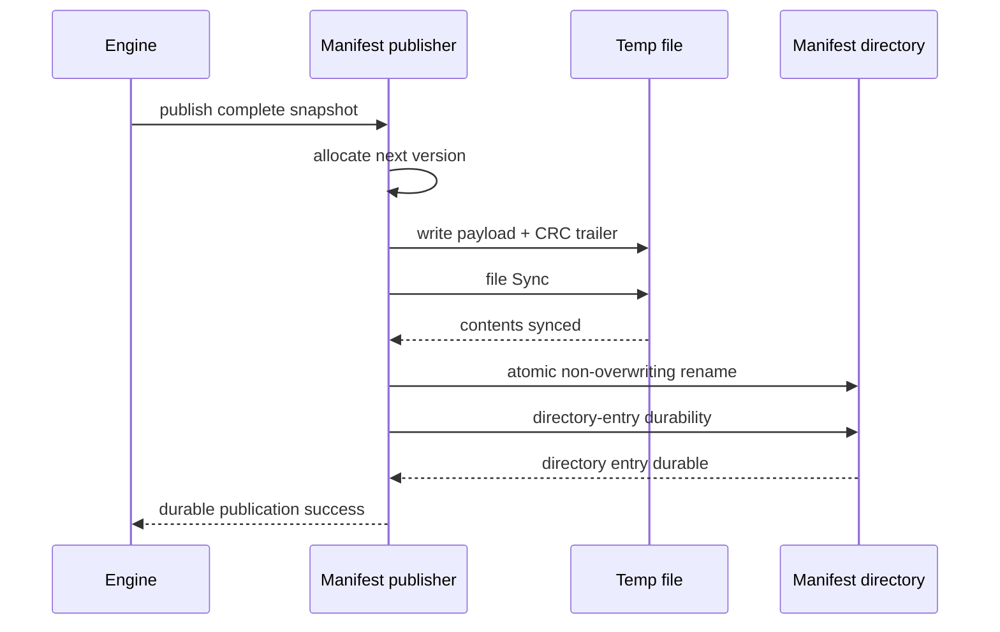
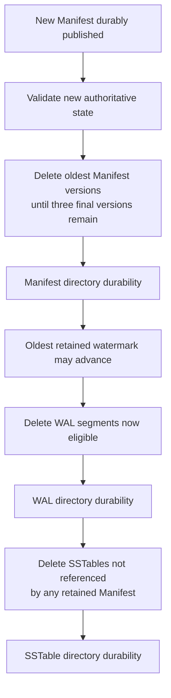
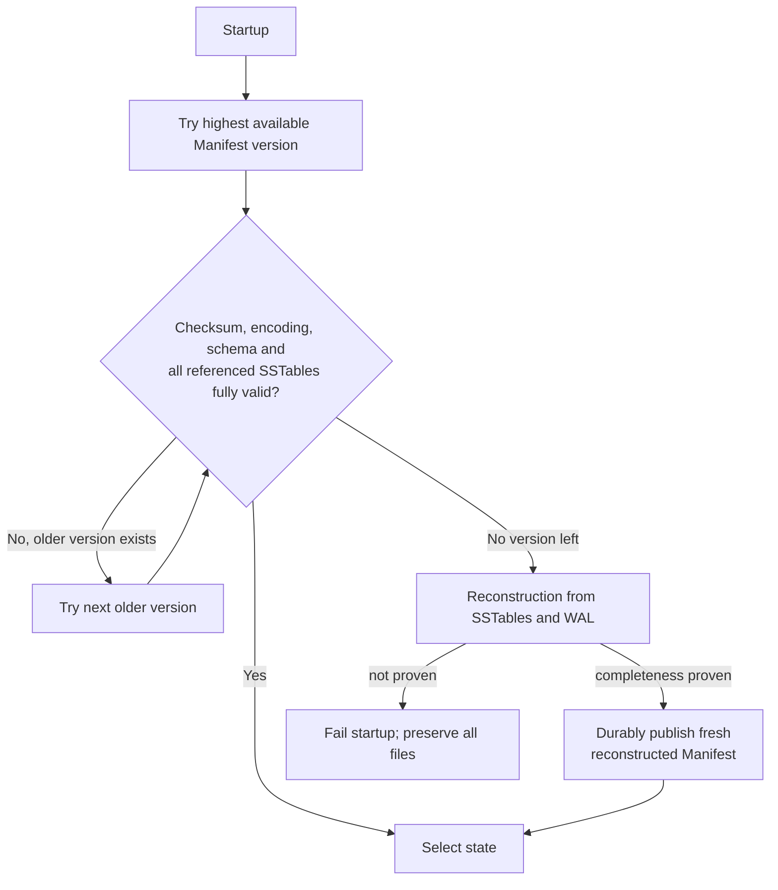

# Manifest Design

> **Status:** Finalized. The Manifest is the authoritative metadata record and is
> encoded as deterministic compact JSON with a CRC32C trailer. The former C-001
> retention conflict and C-002 deletion timing conflict are resolved by the rules
> in this document. See [DECISIONS.md](DECISIONS.md).
>
> **Initial platform:** Windows 10/11 local NTFS through the filesystem
> abstraction. Directory-entry durability is a required platform operation that
> must be validated; see
> [RECOVERY_AND_DURABILITY.md](RECOVERY_AND_DURABILITY.md) §9.

## 1. Purpose and authority

The Manifest contains:

- the database format version;
- the Manifest version;
- `FlushedThroughSeq`;
- `NextSSTableID`;
- metadata for every published SSTable.

It contains no key-value records.

A valid SSTable file is not automatically a published SSTable. Publication is
defined by durable Manifest membership. The Manifest is authoritative for which
SSTables belong to the database, which sequence prefix is durably flushed, and
which files fallback recovery may require.

Phase 1 uses the database layout:

```text
<db>/wal/       WAL segments
<db>/sst/       SSTable files
<db>/manifest/  Manifest versions and temporary files
```

## 2. Files, naming and versions

Final filename:

```text
MANIFEST-%020d
```

Temporary filename:

```text
MANIFEST-%020d.tmp
```

Rules:

- Version numbers start at `1` and increase monotonically.
- The numeric field is exactly 20 zero-padded decimal digits.
- The filename version must equal the JSON `manifest_version`.
- There is no `CURRENT` pointer file.
- A publication attempt uses the next version:
  `max(observed final versions, observed temp versions) + 1`.
- No existing final Manifest file is ever overwritten.
- Temporary files are never authoritative.
- The Manifest directory is the database directory `manifest/`; publication and
  cleanup use its platform directory-entry durability operation.

## 3. Canonical JSON schema

### 3.1 Top-level object

Fields appear in exactly this order:

| Order | Field | JSON type | Width / rule |
|---:|---|---|---|
| 1 | `format_version` | integer | `1` |
| 2 | `manifest_version` | integer | unsigned 64-bit, greater than zero |
| 3 | `flushed_through_seq` | integer | unsigned 64-bit; `0` or greater |
| 4 | `next_sstable_id` | integer | unsigned 64-bit, greater than zero |
| 5 | `sstables` | array | sorted by `sstable_id` ascending |

### 3.2 Per-SSTable object

Each array element has exactly these fields in this order:

| Order | Field | JSON type | Width / rule |
|---:|---|---|---|
| 1 | `sstable_id` | integer | unsigned 64-bit, `1..999999` |
| 2 | `filename` | string | `sstable-%06d.sst`, matching the ID |
| 3 | `level` | integer | `0` in Phase 1 |
| 4 | `file_size` | integer | unsigned 64-bit, greater than zero |
| 5 | `smallest_key_b64` | string | Standard Base64, RFC 4648 §4, with padding |
| 6 | `largest_key_b64` | string | Standard Base64, RFC 4648 §4, with padding |
| 7 | `min_sequence` | integer | unsigned 64-bit, greater than zero |
| 8 | `max_sequence` | integer | unsigned 64-bit, `>= min_sequence` |
| 9 | `checksum` | integer | unsigned 32-bit whole-file CRC32C |
| 10 | `source_wal_segment_id` | integer | unsigned 64-bit, greater than zero |

### 3.3 Canonical serialization

The payload is a single compact JSON object:

- ASCII/UTF-8 bytes, no BOM;
- no spaces, indentation or newlines;
- no trailing newline;
- exactly the fields and field order listed above;
- no unknown or duplicate fields;
- `sstables` is `[]` when empty, never `null`;
- integers are unsigned decimal digits only: no leading zeros (except the value
  `0`), no `+`, no exponent, no fractional part, and within the stated width;
- strings use minimal JSON escaping. Phase 1 filenames and Base64 keys contain
  no characters requiring escapes;
- object keys are case-sensitive.

Readers must reject a payload that is not in this canonical form. A safe
implementation may parse into the fixed struct and re-serialize; if the bytes
differ, the payload is non-canonical. This prevents duplicate-key and
alternative-encoding ambiguity.

Example with no SSTables (one line, no newline):

```json
{"format_version":1,"manifest_version":1,"flushed_through_seq":0,"next_sstable_id":1,"sstables":[]}
```

Example with one SSTable (one line, no newline):

```json
{"format_version":1,"manifest_version":7,"flushed_through_seq":200,"next_sstable_id":18,"sstables":[{"sstable_id":17,"filename":"sstable-000017.sst","level":0,"file_size":12345,"smallest_key_b64":"YQ==","largest_key_b64":"eg==","min_sequence":1,"max_sequence":200,"checksum":3735928559,"source_wal_segment_id":1}]}
```

## 4. Checksum and file structure

A Manifest file is:

```text
canonical JSON payload bytes || 4-byte little-endian CRC32C trailer
```

- The CRC32C uses the Castagnoli polynomial, as with all Phase 1 checksums.
- The checksum covers **the payload bytes only**, excluding the 4-byte trailer.
- The file size is `payload_length + 4`.
- The payload is the complete canonical JSON object.
- There is no checksum field inside the JSON.

Validation reads the whole file, separates the final four bytes, recomputes
CRC32C over the preceding bytes and compares. A mismatch is fatal for that
Manifest version.

## 5. Publication protocol



Numbered contract:

1. Build the complete updated payload.
2. Append the four-byte CRC32C trailer.
3. Write the temporary file `MANIFEST-%020d.tmp`.
4. Sync the temporary file.
5. Atomically rename it to `MANIFEST-%020d` without overwriting.
6. Perform the platform directory-entry durability operation.
7. Only then report successful durable publication.

The Manifest is never overwritten in place. A crash before the rename leaves the
previous Manifest authoritative. A crash after the rename but before directory
durability leaves publication uncertain; recovery considers the surviving
versions in descending order.

Publication is logically idempotent:

- re-publishing the same state is safe and does not duplicate SSTable entries;
- an existing SSTable ID with matching metadata is accepted;
- an existing SSTable ID with conflicting filename, size, bounds, checksum,
  source WAL ID or level is an error;
- a failed attempt is retried with a new Manifest version, never by overwriting
  an existing file.

## 6. Retention and cleanup

### 6.1 Retention rule

After cleanup, retain the latest **three committed Manifest versions**. A
**transient fourth** is permitted during crash-safe publication and recovery must
tolerate it. This resolves C-001: “three” is the post-cleanup target, not a
literal maximum at every instant.

Recovery considers every available final Manifest file, highest version first,
including a transient fourth. A Manifest is a committed fallback candidate only
if it passes full validation, including all referenced SSTables.

An invalid version does not count toward the three committed versions. It is
removed only after a valid higher version is durably published and its removal is
directory-durable. Never delete a valid fallback merely to keep a literal file
count.

### 6.2 Cleanup ordering



Why this order:

1. The new Manifest must be durable before any old version is removed.
2. The retained fallback set must remain sufficient after each removal.
3. Manifest deletion must be durable before a higher watermark is used to delete
   WAL data that the removed Manifest might have required.
4. WAL and SSTable cleanup are independent after the retained Manifest set is
   established, but each deletion must be checked against every retained
   Manifest.
5. Every deletion class is followed by directory-entry durability. Extra files
   are safe; missing required files are not.

A Manifest known to be invalid may be removed during cleanup only after a valid
higher Manifest is durably published and the removal is directory-durable.
Until then, preserve it and do not rely on a higher watermark for WAL deletion.

### 6.3 Crash windows

| Crash point | Possible result | Required behavior |
|---|---|---|
| During temp write | Old Manifest authoritative | Ignore/clean temp |
| After temp Sync, before rename | Old Manifest authoritative | New version not visible |
| After rename, before directory durability | New version may or may not survive | Consider highest valid surviving version |
| After durable publication, before cleanup | Three or four versions | Preserve all; cleanup later |
| After deleting oldest Manifest, before directory durability | Old version may reappear | Do not advance deletion watermark yet |
| After Manifest deletion durability, before WAL deletion | Extra WAL | Safe; retry cleanup |
| During WAL or SSTable deletion | Some files may remain | Extra files are safe; required files must remain |

## 7. SSTable ID allocation

At startup:

```text
NextID = max(Manifest.NextSSTableID, HighestObservedSSTableID + 1)
```

The scan covers the SSTable directory and includes:

- final files matching `sstable-%06d.sst`;
- temporary files matching `sstable-%06d.sst.tmp`;
- valid filenames whose ID is in `1..999,999`.

Rules:

- A valid final or temporary filename establishes an observed ID and consumes
  that ID even if its contents are corrupt.
- Malformed `sstable-` names that do not match either pattern are not valid
  SSTable artifacts. They do not establish an ID, are reported in diagnostics
  and are never treated as published. They are not deleted automatically.
- Unrelated files are ignored.
- Allocation occurs under synchronization.
- Never overwrite an existing SSTable file.
- Never reuse an observed orphan or temporary ID.
- An allocated ID that never produced a file may be reused after restart; this is
  safe because no artifact or Manifest reference exists.
- The updated `NextSSTableID` is persisted in a subsequent Manifest publication.
- Conflicting metadata for an existing ID is an error.
- Exhaustion of the `1..999,999` range is fatal for flush allocation: do not
  wrap, reuse or overwrite. Preserve files and require operator intervention.

## 8. Recovery hierarchy and validation



Hierarchy:

1. Highest available final Manifest version.
2. Next older version.
3. Continue through every available version, including a transient fourth.
4. Reconstruction only when completeness is proven.
5. Otherwise fail startup and preserve all files.

A Manifest is valid only when all of the following hold:

- filename and `manifest_version` agree;
- file has a payload and a four-byte trailer;
- CRC32C trailer matches the payload;
- payload is canonical and has exactly the required fields;
- `format_version` is supported (`1`);
- `next_sstable_id` is greater than every listed SSTable ID;
- SSTable IDs and filenames are unique;
- SSTable metadata is internally consistent;
- every referenced SSTable exists and passes full validation
  ([SSTABLE_DESIGN.md](SSTABLE_DESIGN.md) §13.2);
- each SSTable's header and metadata source identities match the Manifest;
- sequence ranges form a contiguous published prefix starting at `1`;
- `flushed_through_seq` equals the highest `max_sequence` across the listed
  SSTables, or `0` when the list is empty;
- no two SSTables claim the same source generation.

A higher-numbered Manifest that survived a crash before its directory-entry
durability completed may be selected if it and every referenced SSTable are
valid. This proves that the surviving files form a consistent state now; it does
not prove that publication was acknowledged before the crash.

If the newest Manifest references a missing or invalid SSTable, it is unusable.
Fallback continues. The broken reference is never silently skipped.

## 9. Reconstruction

Reconstruction is the last resort when every available Manifest is invalid. It
is allowed only when the surviving files prove a complete, consistent state:

- every adopted SSTable is fully valid;
- every adopted SSTable has its source WAL segment present and valid;
- the SSTable's source GenerationID and source WAL segment ID agree;
- the WAL records for that generation match the SSTable's records;
- generation-to-SSTable mappings are one-to-one;
- sequence ranges are contiguous from `1` with no gaps or conflicts;
- remaining WAL segments are valid, replayable and contain no unexplained
  sequence overlap;
- an unambiguous recovered watermark can be established.

A valid SSTable alone is insufficient. If any adopted SSTable's source WAL is
absent, or any sequence range cannot be explained, completeness is not proven.
Startup must fail, preserve all files and require manual recovery.

Reconstruction must publish a fresh valid Manifest for the adopted state before
admitting writes. Details are in
[RECOVERY_AND_DURABILITY.md](RECOVERY_AND_DURABILITY.md) §8.

## 10. WAL deletion interaction

The Manifest supplies the oldest-retained watermark used by the five-condition
WAL deletion rule. A WAL segment may be deleted only when all conditions hold:

1. its generation's SSTable is durably published through the Manifest;
2. the segment is sealed;
3. the oldest retained Manifest has `FlushedThroughSeq >= WAL.MaxSeq`;
4. the Engine's generation mapping identifies the exact segment;
5. the Engine explicitly authorizes deletion.

“Oldest retained Manifest” is the lowest-numbered Manifest version in the
retained fallback set. If the oldest file is known invalid, it is removed from
the fallback set only after its removal or invalidity is durably established.
Do not delete a WAL immediately after publication in the newest Manifest if any
retained older Manifest still requires it.

An empty generation has no sequence range and produces no SSTable. It does not
advance `FlushedThroughSeq`, so the five-condition rule does not authorize
deletion of its empty WAL segment. No special empty-generation WAL deletion rule
is introduced; an empty generation remains valid. This is D-081, not an open
question.

This resolves C-002. See [WAL_DESIGN.md](WAL_DESIGN.md) §8 and
[DECISIONS.md](DECISIONS.md).

## 11. Invariants

1. The Manifest is authoritative for published SSTables.
2. A valid SSTable is not automatically published.
3. Manifest payloads are canonical compact JSON with the exact documented field
   order.
4. The CRC32C trailer covers the payload only.
5. Publication uses a temporary file, file Sync, atomic non-overwriting rename,
   directory-entry durability, then success.
6. The Manifest is never overwritten in place.
7. Three committed versions are retained after cleanup; a transient fourth is
   allowed during publication.
8. Every available version is considered by recovery, highest first.
9. Every referenced SSTable is fully validated.
10. SSTable IDs are never reused.
11. An orphan's ID remains consumed even if its contents are corrupt.
12. Never delete an SSTable referenced by any retained Manifest.
13. Never delete a WAL needed by any retained Manifest.
14. WAL eligibility uses the oldest retained Manifest watermark.
15. Manifest cleanup precedes deletion of data protected only by the retired
    version.
16. Recovery never initializes an empty database over unrecoverable existing
    files.
17. Reconstruction requires provable completeness.
18. An empty generation produces no SSTable and introduces no special WAL
    deletion rule.

## 12. Related documents

- [SYSTEM_ARCHITECTURE.md](SYSTEM_ARCHITECTURE.md)
- [SSTABLE_DESIGN.md](SSTABLE_DESIGN.md)
- [WAL_DESIGN.md](WAL_DESIGN.md)
- [RECOVERY_AND_DURABILITY.md](RECOVERY_AND_DURABILITY.md)
- [FAILURE_SCENARIOS.md](FAILURE_SCENARIOS.md)
- [DECISIONS.md](DECISIONS.md)
