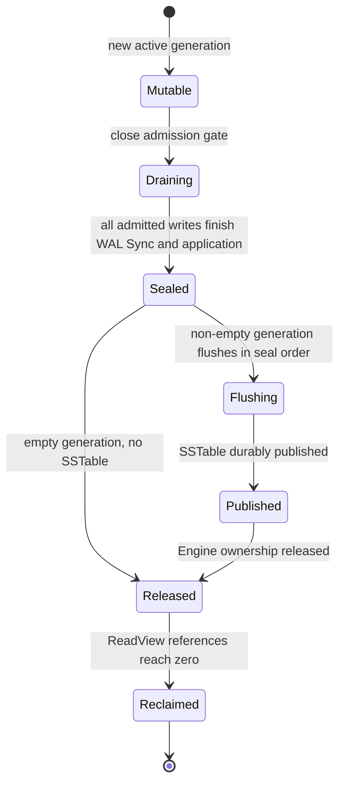
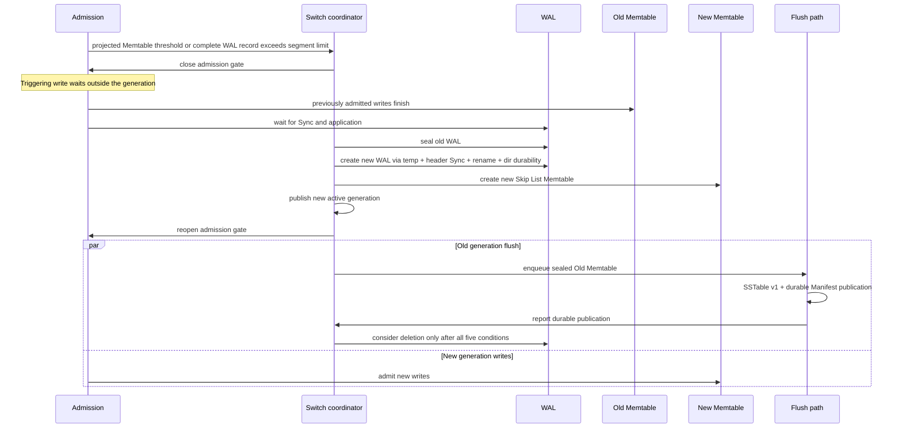
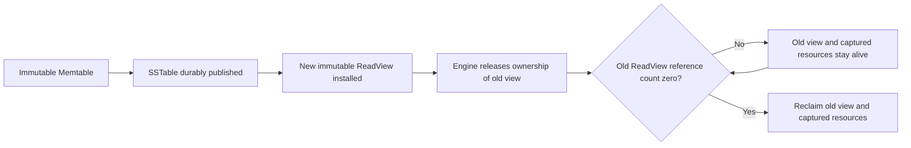

# Memtable Design

> **Status:** Finalized. The Skip List structure, ordered internal keys,
> incremental estimated memory reservations, sequence-ordered application,
> generation switching, ReadView lifetime and immutability are approved contracts.
> Automatic switching has exactly the two pre-admission triggers in D-081. A
> generation with zero admitted records remains valid, produces no SSTable and is
> not itself a switching trigger. ReadView-level reference counting is D-083.

## 1. Purpose

A Memtable is the in-memory write buffer for one generation. It receives
mutations in WAL sequence order, supports concurrent reads while mutable, and
becomes immutable when its generation is sealed. A sealed non-empty generation is
later converted into exactly one SSTable publication. A sealed empty generation
produces no SSTable and no sequence range.

The Memtable is not a cache. It is part of the durable state machine: a record is
not acknowledged until it has been both synced in the WAL and successfully
applied to the Memtable.

## 2. Skip List structure

The Memtable uses a **Skip List**.

The ordered internal key is:

```text
(user_key, sequence)
```

Ordering rules:

- user keys are compared lexicographically by their raw bytes, ascending;
- for the same user key, sequence numbers are ordered descending, so the newest
  version is encountered first;
- an entry stores its sequence number, entry type and value;
- a Delete is a tombstone with no value;
- no older value may reappear because a tombstone was discarded early.

The Skip List must support:

- ordered insertion during sequence-ordered application;
- concurrent reads while the active Memtable is mutable;
- ordered iteration in user-key ascending / sequence-descending order for flush;
- point lookup by user key and sequence.

Mutation application is serialized in ascending sequence order. Readers may run
concurrently with application. The concrete synchronization primitives, node
height distribution and memory layout are implementation choices, but they must
provide these semantics and must be compatible with the reservation accounting in
§4.

The active Memtable is mutable. A sealed Memtable is immutable and may be read
and flushed while new writes continue in a new generation.

## 3. Writes, sequence ordering and acknowledgement

The WAL assigns the sequence. The Engine applies records in ascending sequence
order, regardless of which request finished WAL processing first.

```text
Write A -> WAL sequence 101
Write B -> WAL sequence 102

Even if B's WAL completion is observed first:
  apply A (101)
  then apply B (102)
```

A higher sequence must not be applied while a lower admitted sequence is
unapplied. This preserves a prefix-consistent visible state and ensures that the
Manifest’s `FlushedThroughSeq` can be advanced monotonically.

A client acknowledgement requires:

1. successful WAL `Sync`; and
2. successful Memtable application.

If Memtable application fails after WAL `Sync`:

- mark the Engine failed;
- reject new writes and reads;
- fail affected in-flight requests;
- do not skip the failed sequence;
- do not apply later sequences;
- require close/reopen and WAL recovery.

The WAL remains the source of truth.

## 4. Incremental estimated memory accounting

Memory accounting uses **incremental estimated allocation reservations**. It does
not scan the entire Memtable to calculate usage.

### 4.1 Estimate before admission

Before a write is admitted, the Engine calculates one estimated allocation
requirement for that write. The estimate includes:

- key bytes;
- value bytes;
- entry/object overhead;
- Skip List node overhead;
- any other allocation associated with the chosen implementation;
- a conservative safety margin.

The estimator must be conservative: the reserved amount must be greater than or
equal to the memory the implementation will account for the entry. The exact
formula and safety margin depend on the actual Go implementation and allocator
behavior. They are an implementation validation requirement, not a fixed
architectural constant.

### 4.2 Reservation check

Under the admission lock, the Engine checks:

```text
ActualUsage + ReservedBytes + NewReservation <= HardLimit
```

Definitions:

- `ActualUsage`: memory already converted from successful Memtable
  applications;
- `ReservedBytes`: the sum of reservations for writes that were admitted but
  have not yet completed application;
- `NewReservation`: the estimate for the candidate write.

The write is reserved before admission. It must never be admitted on the
assumption that capacity will be found later.

### 4.3 Conversion and release

- After successful Memtable application, the reservation is converted into
  actual usage accounting.
- If the actual accounted size is less than or equal to the reservation, the
  difference is released.
- If the actual accounted size exceeds the reservation, that is an estimator or
  accounting invariant violation. The Engine must fail-stop rather than allow the
  hard limit to be exceeded silently.
- If the write fails before application, the reservation is released.
- If the write fails after a fail-stop, recovery starts from the WAL; the failed
  in-memory reservation is not reused.

### 4.4 Limits and switching

A configurable switching threshold is set below the Memtable’s hard maximum.
Example only:

```text
hard maximum:       100 MB
switching threshold: 98 MB
```

The 98 MB value is illustrative, not a fixed requirement. The threshold is not
the hard maximum.

**Exactly two automatic switching triggers exist.** Both are evaluated before a
write is admitted:

1. **Memtable threshold.** After calculating the candidate write’s estimated
   reservation, if

   ```text
   ActualUsage + ReservedBytes + NewReservation >= SwitchingThreshold
   ```

   the Engine initiates the generation switch before admitting the write. The
   waiting write is admitted into the new generation after the switch completes.

2. **WAL segment limit.** After calculating the complete encoded WAL record size,
   if appending that record would exceed the active segment’s configured size
   limit, the Engine initiates the generation switch before admitting the write.
   The waiting write is admitted into the new generation’s WAL after the switch
   completes.

Additional rules:

- Emptiness itself is never a trigger. An empty Memtable with no candidate write
  that crosses a trigger does not switch.
- Startup, shutdown, flush completion and timers do not independently trigger a
  switch. There is no timer-based automatic switching.
- No other automatic switching condition exists.
- The Memtable hard limit remains a separate safety boundary, not a third
  switching trigger. A reservation larger than the hard limit is rejected with an
  explicit resource error. If current usage plus outstanding reservations plus the
  new reservation would exceed the hard limit, admission waits for capacity to be
  released; it never over-admits.
- A write whose complete encoded record cannot fit within the configured WAL
  segment limit even in a fresh segment is rejected explicitly rather than
  switching repeatedly.
- Already-admitted writes retain their reservations and may complete against
  them.
- The Memtable must never exceed its hard maximum.

## 5. Generation model

A generation is the identity binding:

- GenerationID;
- WAL segment ID;
- one Memtable;
- one normal SSTable publication.

**GenerationID equals the WAL segment ID.** There is no separate durable
generation counter or registry. The Memtable identity itself is runtime state.

The approved normal relationship is:

```text
one WAL segment -> one Memtable generation -> one SSTable publication
```

Example:

```text
WAL segment 1 (GenerationID 1) -> Memtable-1 -> SSTable-17
WAL segment 2 (GenerationID 2) -> Memtable-2 -> SSTable-18
```

The same identity must be carried through:

- sealing;
- flush;
- SSTable creation and validation;
- Manifest publication;
- WAL deletion authorization;
- Engine ownership release.

Each SSTable header records its source GenerationID and source WAL segment ID;
in v1 they must be equal. Manifest metadata records the source WAL segment ID.
Recovery verifies the mapping before authorizing deletion.

A generation with zero admitted records is still a valid generation. It has no
sequence range to flush, does not advance `FlushedThroughSeq`, produces no
SSTable publication and creates no empty SSTable. Its empty WAL segment remains
valid. The five-condition WAL deletion rule gains no empty-generation exception,
and no special WAL deletion rule is introduced for empty generations. See D-081.

## 6. Mutable and immutable states



Clarifications:

- `Draining` means the gate is closed but admitted writes are still completing.
  The Memtable must not be treated as immutable or sealed during this state.
- A generation cannot be sealed until all writes admitted before the gate closed
  have finished their WAL `Sync` and Memtable application.
- A `Sealed` Memtable is immutable: it accepts no new writes.
- The old Memtable may flush while new writes continue in the new generation.
- A Memtable must never be reclaimed while any ReadView still references it.
- `Published` means the SSTable publication is durable and Engine ownership may
  be released; it does not mean the Memtable memory is immediately reclaimed.

## 7. Generation switching protocol

The switch briefly closes admission for new writes.



Protocol:

1. A candidate write is checked against both pre-admission triggers in §4.4.
2. Acquire the write-switch coordination mechanism.
3. Close the admission gate for new writes.
4. Previously admitted writes remain assigned to the old generation.
5. Wait for all previously admitted writes to finish WAL `Sync` and Memtable
   application.
6. Seal the old WAL.
7. Create the new WAL using the temporary-file creation protocol.
8. Create a new Skip List Memtable.
9. Switch the active generation.
10. Reopen the admission gate.
11. The waiting triggering write and later new writes are assigned to the new
    generation.

Writes arriving while the gate is closed wait outside the generation and are
admitted into the new generation afterward. An already-admitted write belongs to
its original generation and must finish there. Switching is initiated only by one
of the two triggers in §4.4; an empty Memtable, startup, shutdown, flush
completion and timers do not initiate a switch.

The old immutable Memtable flushes independently of new-generation writes.
Flush publication is serialized in seal order so `FlushedThroughSeq` remains a
contiguous prefix. The old WAL remains retained until the old generation’s
SSTable is durably published and all five WAL deletion conditions hold.

## 8. Reader lifetime and ReadViews

Memtable lifetime is owned through **ReadViews**, not through per-table reader
reference counts. The currently published ReadView holds an ownership reference
over every resource captured by that view.

A published ReadView captures one consistent state:

- one `read_sequence`;
- one consistent active and immutable Memtable set;
- one immutable published-SSTable metadata view.

### 8.1 Reader acquisition and release

The required reader protocol is:

1. Acquire `RLock` on the ReadView-publication `sync.RWMutex`.
2. Capture the currently published ReadView.
3. Increment that ReadView’s reference count while still holding `RLock`.
4. Release `RLock`.
5. Perform the entire read using the captured ReadView.
6. Release the ReadView reference exactly once when the read operation finishes,
   whether the key was found, was not found, or an error occurred.

A key found in the active Memtable does not permit early release. The reference
covers the whole `Get` operation. A naive atomic-pointer load followed by an
unsynchronized reference increment is forbidden.

### 8.2 Publisher protocol and reclamation

The required publisher protocol is:

1. Construct a complete new immutable ReadView.
2. Acquire the write lock.
3. Install the new ReadView as the current published view.
4. Release the old published ReadView’s ownership reference.
5. Release the write lock.
6. Reclaim the old view and its resources only when its reference count reaches
   zero.

After SSTable publication and installation of the new ReadView:

- the Engine releases its ownership of the old immutable Memtable;
- existing readers may continue using their captured ReadView;
- new reads acquire the new ReadView and use the new Memtable and published
  SSTable state;
- the old ReadView and captured resources are reclaimed only after all reader
  references are released.



Never reclaim a Memtable or SSTable resource while any ReadView that captured it
is still referenced. The acquisition/publication protocol and its coordination
with switching and Manifest publication are defined in
[CONCURRENCY_AND_LIFECYCLE.md](CONCURRENCY_AND_LIFECYCLE.md) §6.

## 9. Interactions with other components

### WAL

- The WAL assigns sequences; the Memtable applies them in order.
- The WAL segment ID is the GenerationID.
- The WAL record remains the recovery source until the generation’s SSTable is
  durably published and all five deletion conditions hold.
- Memtable application failure after WAL `Sync` is an Engine fail-stop condition.

### SSTable

- A sealed non-empty generation is flushed into exactly one SSTable publication.
- The SSTable is built by ordered iteration of the Skip List.
- A valid SSTable file is not enough; Manifest publication and directory
  durability are required before the generation is considered flushed.

### Manifest

- The Manifest records the resulting SSTable, its source WAL segment ID and
  advances `FlushedThroughSeq` only when all lower sequences are durably
  represented.
- The generation mapping must remain consistent through publication and deletion
  authorization.

### Engine

- The Engine owns generation switching, capacity policy, flush coordination and
  WAL deletion authorization.
- The Engine must not release its Memtable ownership before durable publication
  and ReadView installation.

## 10. Failure behavior

| Failure | Required behavior |
|---|---|
| WAL Sync failure before application | Engine fails the affected writes; WAL fail-stop; close/reopen and recover |
| Memtable application failure after WAL Sync | Engine fail-stop; reject reads and writes; do not skip the sequence or apply later sequences; recover from WAL |
| Generation switch interrupted by crash | Recovery rebuilds per-segment generations from Manifest and WAL; no acknowledged write may be lost |
| SSTable publication failure | Retain immutable Memtable and WAL; do not complete flush; reconcile safely |
| Reader still holds old ReadView | Keep the old view and its captured resources alive until its reference count reaches zero |
| Reservation cannot fit | Do not admit; backpressure until capacity or return a resource error |
| Reservation cannot fit even in a fresh WAL segment | Reject explicitly; do not switch repeatedly |
| Empty generation sealed | Remains a valid generation; no SSTable is created; no special WAL deletion rule applies |
| Estimator undercounts actual usage | Invariant violation; fail-stop rather than exceed the hard limit |

## 11. Invariants specific to the Memtable

1. The Memtable is a Skip List ordered by user key ascending and sequence
   descending.
2. Memtable application follows ascending WAL sequence order.
3. A generation cannot be sealed until all admitted writes finish.
4. A sealed Memtable accepts no new writes.
5. A reservation is obtained before admission and protects the admitted write.
6. The hard maximum is never exceeded.
7. Reservations are converted to actual usage after successful application and
   released on pre-application failure.
8. One WAL segment belongs to one generation. A non-empty generation produces one
   SSTable publication; an empty generation produces none and remains valid.
9. GenerationID equals the WAL segment ID; no separate durable counter exists.
10. A published ReadView owns its captured resources. Readers reference the
    ReadView, not individual Memtables or SSTables.
11. Engine ownership may be released only after durable SSTable publication and
    installation of a new ReadView; reclamation occurs only at ReadView reference
    count zero.
12. Memtable application failure is fail-stop, not a skipped sequence.
13. No lower sequence may be missing while a higher sequence is visible.
14. Tombstones are retained and can never cause an older value to reappear.
15. Automatic switching has exactly two pre-admission triggers: the projected
    Memtable threshold and the complete next WAL record exceeding the segment
    limit.
16. Empty Memtables, startup, shutdown, flush completion and timers do not trigger
    switching.
17. A reader’s ReadView reference is acquired while `RLock` is held and released
    exactly once on every exit path.

## 12. Related documents

- [SYSTEM_ARCHITECTURE.md](SYSTEM_ARCHITECTURE.md)
- [WAL_DESIGN.md](WAL_DESIGN.md)
- [SSTABLE_DESIGN.md](SSTABLE_DESIGN.md)
- [MANIFEST_DESIGN.md](MANIFEST_DESIGN.md)
- [CONCURRENCY_AND_LIFECYCLE.md](CONCURRENCY_AND_LIFECYCLE.md)
- [OPEN_QUESTIONS.md](OPEN_QUESTIONS.md)
- [DECISIONS.md](DECISIONS.md)
