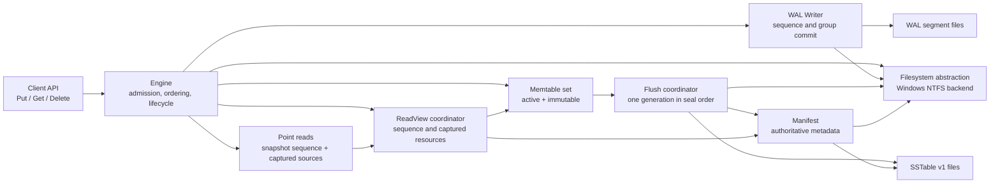

# RaftKV Phase 1 Architecture

> **Status:** Finalized architecture specification for Phase 1. This is a
> documentation deliverable only; it does not authorize or contain an
> implementation.
>
> **Initial platform:** Windows 10/11 with local NTFS storage. Linux is a future
> backend, not the initial target.
>
> **Decision record:** [DECISIONS.md](DECISIONS.md). Remaining implementation
> validation requirements are in [OPEN_QUESTIONS.md](OPEN_QUESTIONS.md). No open
> architectural policy remains.

## 1. Project overview

RaftKV is a distributed, fault-tolerant key-value database written in Go. Its
long-term architecture combines Raft consensus with a custom LSM-tree storage
engine. The database exposes three initial operations:

- `Put(key, value)`
- `Get(key)`
- `Delete(key)`

The initial distributed target is a three-node cluster. That target is future
work. Phase 1 is a **single-node persistent storage engine**.

## 2. Phase 1 scope and platform

Phase 1 establishes the local durable state machine that a future Raft
implementation will drive. It includes:

- a single-node key-value engine;
- a write-ahead log (WAL) with group commit and crash recovery;
- Skip List Memtables with sequence-ordered writes, incremental estimated
  memory reservations and ReadView-level reference counting;
- exactly two pre-admission generation-switching triggers: the projected
  Memtable threshold and the complete next WAL record exceeding the segment
  size limit;
- immutable, sorted SSTables with a precise block-based v1 binary format;
- a versioned Manifest using deterministic JSON and CRC32C integrity;
- generation switching coordinated with WAL rotation;
- flush, durable publication, WAL deletion authorization and cleanup;
- full validation of every Manifest-referenced SSTable during recovery;
- safe reconstruction from SSTables and WAL only when completeness is provable;
- caller-context graceful shutdown and fail-stop behavior for WAL and Memtable
  failures;
- a filesystem abstraction whose initial backend targets Windows 10/11 NTFS.

Phase 1 does **not** include:

- Raft leaders, followers, elections, log replication or membership;
- multi-node deployment;
- snapshots and log compaction;
- compaction and level management beyond level 0 flush output;
- Bloom filters, prefix compression or block caching;
- benchmarking and release packaging;
- forced resource closure on shutdown-context expiry;
- timer-based or lifecycle-triggered generation switching;
- empty SSTables for empty generations;
- recovery of an inconsistent database by guessing;
- Linux as an initial target; Linux is future work and outside Phase 1;
- any implementation of the components described here.

## 3. Roadmap

| Phase | Name | Status | Scope |
|---|---|---|---|
| 0 | Go Systems Foundations | Completed | Go fundamentals and systems prerequisites |
| 1 | Single-node persistent LSM-tree storage engine | **Current** | WAL, Memtable, SSTable, Manifest, recovery, Windows/NTFS durability |
| 2 | LSM-tree optimizations and reliability | Future | Compaction, Bloom filters, further reliability work |
| 3 | Raft consensus implementation | Future | Consensus and replication |
| 4 | Raft and storage-engine integration | Future | Replicated state machine integration |
| 5 | Snapshots, reliability and fault injection | Future | Snapshotting and broader fault testing |
| 6 | Benchmarking, documentation and release | Future | Performance and release work |

Future-phase features are described only where necessary to explain a boundary.
No Raft algorithm, wire protocol, snapshot format or compaction design is
introduced here.

## 4. Document navigation

| Document | Purpose |
|---|---|
| [SYSTEM_ARCHITECTURE.md](SYSTEM_ARCHITECTURE.md) | Component ownership, data flows, generation identity, ReadViews and invariants |
| [WAL_DESIGN.md](WAL_DESIGN.md) | Final WAL format, group commit, segment creation, recovery and deletion authorization |
| [MEMTABLE_DESIGN.md](MEMTABLE_DESIGN.md) | Skip List structure, incremental reservations, generations, ordering and lifetime |
| [SSTABLE_DESIGN.md](SSTABLE_DESIGN.md) | Exact v1 binary format, creation, full validation and orphan handling |
| [MANIFEST_DESIGN.md](MANIFEST_DESIGN.md) | Deterministic JSON schema, CRC32C, naming, publication, retention, ID allocation and reconstruction |
| [RECOVERY_AND_DURABILITY.md](RECOVERY_AND_DURABILITY.md) | Recovery ordering, durability boundaries, Windows requirements, reconstruction and data-loss limits |
| [CONCURRENCY_AND_LIFECYCLE.md](CONCURRENCY_AND_LIFECYCLE.md) | Admission, ReadViews, switching, flush coordination, failure states and shutdown |
| [FAILURE_SCENARIOS.md](FAILURE_SCENARIOS.md) | Crash-point and reconciliation analysis for every required behavior |
| [IMPLEMENTATION_PLAN.md](IMPLEMENTATION_PLAN.md) | Future implementation order, dependencies, validation gates and testing |
| [OPEN_QUESTIONS.md](OPEN_QUESTIONS.md) | Remaining implementation validation requirements (AQ-003, AQ-004, AQ-006 and AQ-005 follow-up) |
| [DECISIONS.md](DECISIONS.md) | Permanent architectural decision record with final status and rationale |

## 5. Architecture at a glance

A valid SSTable is not automatically part of the database. It becomes
authoritative only when the Manifest durably publishes it. WAL records are not
acknowledged to a client merely because they were written; the WAL `Sync` and
the Memtable application must both succeed.

## 6. Final architecture summary

### Write path

1. The Engine validates the mutation and checks both pre-admission switching
   triggers: projected Memtable usage at the switching threshold, and the complete
   encoded WAL record exceeding the segment-size limit. If one triggers, the
   waiting write is admitted into the new generation after switching.
2. The Engine obtains an estimated memory reservation for the active Memtable
   generation.
3. The WAL Writer assigns the sequence, batches the record, writes the batch and
   performs one `Sync`.
4. The Engine applies records to the Memtable in ascending sequence order.
5. The client receives success only after both the WAL `Sync` and Memtable
   application complete.

### Read path

1. A reader acquires the short-held publication `RLock`, captures the current
   published ReadView, increments its reference count while still holding `RLock`,
   then releases `RLock`.
2. The ReadView captures one `read_sequence`, one consistent active/immutable
   Memtable set, and one immutable published-SSTable metadata view.
3. Lookups inspect the active Memtable, immutable Memtables newest to oldest,
   then published SSTables newest to oldest, and return the newest version with
   sequence at or below `read_sequence`.
4. A tombstone at that version means “not found.” Older values must not
   reappear.
5. The reader releases its ReadView reference exactly once when the operation
   finishes, whether the key is found, not found, or an error occurs.

### Flush and publication

1. A sealed immutable generation is flushed in sorted key order into exactly one
   SSTable.
2. The SSTable is written to a temporary file, synced, fully validated, closed,
   atomically renamed to its final name, and made directory-durable.
3. The Manifest is updated by complete snapshot: temporary file, sync, atomic
   rename, directory durability.
4. Only then is the new immutable ReadView installed, the old ReadView’s
   ownership reference released, and WAL deletion considered.

### WAL deletion

A WAL segment may be deleted only when all of the following hold:

1. its generation’s SSTable is durably published through the Manifest;
2. the segment is sealed;
3. the oldest retained Manifest has `FlushedThroughSeq >= WAL.MaxSeq`;
4. the Engine’s generation mapping identifies the exact segment; and
5. the Engine explicitly authorizes deletion.

The WAL performs the physical deletion and directory durability operation.

## 7. Terminology

| Term | Meaning |
|---|---|
| **WAL** | Write-ahead log. Append-only durable record stream used for crash recovery. |
| **WAL segment** | One `wal-%020d.wal` file with a 20-byte header and length-framed records. |
| **Active WAL** | The one segment currently accepting new records. It is never authorized for deletion. |
| **Sealed WAL** | A segment closed to new appends. Sealing alone does not permit deletion. |
| **Sequence number** | Strictly increasing number assigned by the WAL Writer to admitted mutations. Durable sequence numbers are gap-free; an unacknowledged lost suffix may be reused after recovery. |
| **GenerationID** | The WAL segment ID. It is the generation identity; there is no separate durable generation counter. |
| **Generation** | The identity binding one WAL segment, one Memtable generation and one normal SSTable publication. |
| **SSTable ID** | Independently allocated stable identifier for an SSTable file. It is not a generation ID. |
| **Mutable Memtable** | The Skip List currently receiving the active generation’s writes. |
| **Immutable Memtable** | A sealed Memtable that may be read and flushed but accepts no new writes. |
| **ReadView** | The reference-counted publication unit containing one read sequence, one consistent Memtable set and one immutable published-SSTable metadata view. Readers reference the ReadView, not individual tables. |
| **Flush** | Conversion of one immutable Memtable generation into one SSTable publication. |
| **SSTable** | Immutable sorted string table stored in the exact v1 block format. |
| **Published SSTable** | An SSTable referenced by the durable authoritative Manifest. A valid file is not enough. |
| **Manifest** | Complete authoritative metadata snapshot encoded as deterministic JSON plus a CRC32C trailer. |
| **FlushedThroughSeq** | Highest sequence for which all records at or below it are represented in durably published SSTables. |
| **Durable publication** | The required file-content flush, atomic rename and platform directory-entry durability step completed and the publisher reported success. |
| **Directory durability** | The platform-specific operation that makes directory-entry creation, rename or deletion persistent. On Windows this mechanism requires explicit validation. |
| **Filesystem backend** | The implementation of the filesystem abstraction for a supported platform; Phase 1 provides the Windows NTFS backend. |
| **Written** | Handed to the operating system through a write operation. Not necessarily durable. |
| **Synced** | A successful file `Sync` completed for all preceding bytes. |
| **Acknowledged write** | A client received success after WAL `Sync` and successful Memtable application. |
| **WAL append success** | The record’s group batch completed a successful WAL `Sync`. This is not a client acknowledgement. |
| **Logical deletion** | The Engine has decided that a WAL or SSTable is no longer required. |
| **Physical deletion** | The file has actually been unlinked and the deletion’s directory durability is handled. |
| **Full integrity validation** | Reading and verifying every relevant structure, data block and checksum. Required during creation and during recovery for every referenced SSTable. |
| **Reconstruction** | Last-resort recovery from SSTables and WAL when all retained Manifests are invalid; allowed only when completeness is proven. |
| **Incomplete tail** | A final record cut short by physical EOF in the newest WAL segment. |
| **Corruption** | A complete record with a bad checksum, an invalid field, or an invalid middle-of-file structure. Corruption is not an incomplete tail. |

## 8. Reading order

For a new contributor, read in this order:

1. [SYSTEM_ARCHITECTURE.md](SYSTEM_ARCHITECTURE.md) for ownership, generations,
   ReadViews and invariants;
2. [WAL_DESIGN.md](WAL_DESIGN.md) for the durability boundary and recovery
   source;
3. [MEMTABLE_DESIGN.md](MEMTABLE_DESIGN.md) for Skip List ordering,
   reservations and generations;
4. [SSTABLE_DESIGN.md](SSTABLE_DESIGN.md) and
   [MANIFEST_DESIGN.md](MANIFEST_DESIGN.md) for exact formats and publication;
5. [RECOVERY_AND_DURABILITY.md](RECOVERY_AND_DURABILITY.md) and
   [FAILURE_SCENARIOS.md](FAILURE_SCENARIOS.md) for crash behavior;
6. [CONCURRENCY_AND_LIFECYCLE.md](CONCURRENCY_AND_LIFECYCLE.md) for runtime
   coordination;
7. [OPEN_QUESTIONS.md](OPEN_QUESTIONS.md) before implementation to identify the
   platform and validation tasks that still require execution.

## 9. Non-goals and prohibited assumptions

- Do not infer that a filename or version number alone proves durable Manifest
  publication.
- Do not infer that a valid SSTable is published.
- Do not infer that a WAL file can be deleted because a newer Manifest exists.
- Do not infer that an incomplete final record and a full-length checksum failure
  are the same condition.
- Do not infer that a failed `Sync` means the data is absent.
- Do not infer that an arbitrary orphan SSTable can be adopted.
- Do not infer that Windows directory-entry durability is equivalent to Linux
  directory `fsync`.
- Do not treat an unsupported platform durability operation as success.
- Do not infer a concrete Memtable-internal synchronization primitive, Manifest
  cleanup scheduling, compaction policy or Raft protocol from this documentation.
- Do not infer that context expiry authorizes forced shutdown or resource
  closure.
- Do not infer that an empty generation creates an empty SSTable or a special WAL
  deletion rule.
- Do not infer that a timer, startup, shutdown or flush completion triggers a
  generation switch.

## 10. Architectural status

The architecture review has finalized:

- the Skip List Memtable and incremental estimated memory reservations;
- exactly two pre-admission generation-switching triggers, with empty generations
  remaining valid and producing no SSTable;
- the final WAL record format and operational defaults;
- `GenerationID = WAL segment ID`, with no separate durable generation counter;
- ReadView-level reference counting under a short-held `sync.RWMutex`, with one
  captured sequence and one consistent published view;
- caller-context graceful shutdown that never forces resource closure on context
  expiry;
- the SSTable v1 binary format and durable creation protocol;
- full SSTable validation during recovery;
- deterministic Manifest JSON, CRC32C coverage and versioned naming;
- three committed Manifest versions after cleanup, with a permitted transient
  fourth during publication;
- the five-condition WAL deletion rule, including oldest-retained-Manifest
  coverage;
- SSTable ID allocation from `NextSSTableID` plus a startup filename scan;
- the reconstruction completeness predicate;
- fail-stop read rejection and the full caller-context shutdown sequence;
- Windows 10/11 local NTFS as the initial platform, behind a filesystem
  abstraction.

There are no remaining active architecture conflicts. The previously documented
C-001 (Manifest retention versus transient fourth) and C-002 (WAL deletion versus
oldest-retained-Manifest eligibility) conflicts are resolved by the final
retention and deletion rules recorded in [DECISIONS.md](DECISIONS.md).

Implementation validation requirements remain: AQ-003 Windows directory-entry
durability, AQ-004 memory-estimator calibration, AQ-006 crash and power-loss
verification, and the AQ-005 ReadView validation work. They must not be presented
as tested guarantees. In particular, the exact Windows directory-entry durability
mechanism requires implementation-time verification; see
[OPEN_QUESTIONS.md](OPEN_QUESTIONS.md) and
[RECOVERY_AND_DURABILITY.md](RECOVERY_AND_DURABILITY.md).
