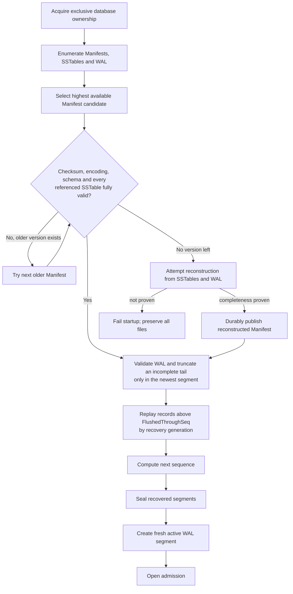
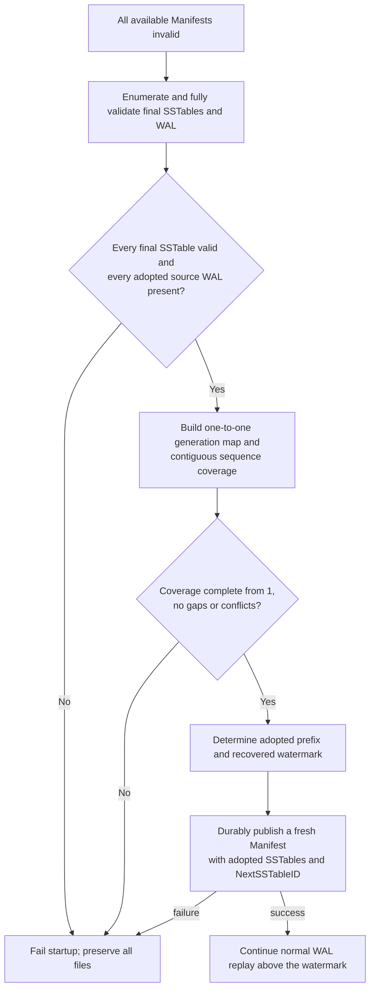

# Recovery and Durability

> **Status:** Finalized recovery rules and durability boundaries. The Windows
> directory-entry durability mechanism is an implementation validation
> requirement, not a tested guarantee. See [OPEN_QUESTIONS.md](OPEN_QUESTIONS.md).
>
> **Initial platform:** Windows 10/11 local NTFS storage through the filesystem
> abstraction. Linux is future work; network drives are outside Phase 1.

## 1. Purpose

This document defines what “durable” means in Phase 1, how startup reconstructs
state, what is recovered automatically, what must fail, and what data may or may
not be deleted.

Recovery is not a best-effort salvage process. It must preserve every
acknowledged write. If it cannot prove a consistent state, it must fail and
preserve files rather than guess.

## 2. Durability model

### 2.1 Written, synced, acknowledged and published

| State | Meaning |
|---|---|
| Written | Passed to the operating system. May still be cached. |
| Synced | A successful file `Sync` completed for all preceding bytes. |
| WAL append success | The containing group batch completed a successful `Sync`. |
| Acknowledged | The client received success after WAL `Sync` and successful Memtable application. |
| Durable publication | Required file contents, atomic rename and platform directory-entry durability completed, and the publisher reported success. |

A successful `Sync` is the WAL durability boundary. A failed `Sync` leaves the
outcome uncertain; it does not prove the data is absent.

### 2.2 Directory-entry durability

Atomic rename changes directory metadata. A file-content `Sync` does not make a
new filename durable. WAL segment creation, SSTable creation and Manifest
publication therefore require a platform directory-entry durability operation
after the rename.

Deletion also changes directory metadata. WAL and Manifest cleanup perform the
platform operation after deletion. If the operation is unavailable, the backend
must return an error; it must not silently report success.

The approved protocol is logical. The Windows mechanism that implements it is
not assumed by this document and requires validation.

### 2.3 Platform assumptions

The architecture requires, but does not by itself prove:

- atomic same-volume rename for the supported Windows operation;
- non-overwriting rename semantics for SSTable and Manifest publication;
- file `Sync` durability for WAL, SSTable and Manifest contents;
- persistence of directory-entry creation, rename and deletion on local NTFS.

These are validation targets on Windows. No scenario may claim a stronger
guarantee than the platform and filesystem actually provide.

## 3. Durability boundaries

| Operation | Boundary | Crash before boundary | Crash after boundary |
|---|---|---|---|
| WAL batch | Successful file `Sync` | Records may be absent, partial or present but unacknowledged | Records durable; replayable |
| WAL segment creation | Header temp Sync, rename, directory-entry durability | New segment not trusted; no writes accepted | New segment established; writes may be accepted |
| WAL deletion | Segment unlink + directory-entry durability | Segment may remain or deletion may not persist | Segment absence is durable |
| SSTable build | Complete write + file Sync + full validation | Not publishable; source retained | Valid file; publication still required |
| SSTable filename | Non-overwriting rename + directory-entry durability | Manifest must not reference it | Final name is durably established |
| SSTable publication | Manifest file Sync + rename + directory-entry durability | Old Manifest remains authoritative; SSTable is an orphan | Publication durable |
| Manifest cleanup | Retired Manifest unlink + directory-entry durability | Old version may remain | Retired version absent durably |

A successful Manifest directory-entry durability step is the durable publication
boundary. Recovery may select a higher-numbered valid Manifest that survived even
if the pre-crash directory step was not observed. Durable publication and
“best surviving consistent state” are related but not identical claims.

## 4. Recovery ordering

Required ordering:

1. Manifest selection precedes WAL replay because `FlushedThroughSeq` determines
   which records are already represented.
2. Every referenced SSTable is fully validated before its Manifest is usable.
3. WAL records at or below the selected watermark are not replayed.
4. WAL records above the watermark are replayed in ascending sequence order.
5. An incomplete tail is truncated only in the newest WAL segment.
6. Any other corruption fails startup rather than being skipped.
7. After recovery, existing segments are sealed and a fresh active segment is
   created.
8. No empty database is initialized when existing database artifacts cannot be
   recovered.

## 5. Manifest fallback

The hierarchy is:

1. highest available final Manifest version;
2. next older version;
3. every remaining available version, including a transient fourth;
4. reconstruction from SSTables and WAL;
5. fail startup and preserve files.

A Manifest is not valid merely because it parses. Its filename, canonical JSON,
CRC32C trailer, format version, schema, SSTable metadata and every referenced
SSTable must validate. If a referenced SSTable is missing, structurally invalid,
checksum-invalid or metadata-mismatched, that Manifest is unusable and fallback
continues.

### 5.1 Highest valid version and durability ambiguity

A crash after Manifest rename but before directory-entry durability can leave a
higher-numbered Manifest that is complete and valid even though durable
publication was not reported. Recovery selects the highest valid version. If all
referenced SSTables are valid, this is a consistent state and may be adopted.

This is not proof that publication was durable before the crash. It is proof
that the surviving files form a consistent state now. If referenced files are
missing or invalid, fallback continues.

### 5.2 Fallback data

An older retained Manifest may require:

- WAL records above its `FlushedThroughSeq` but below the newest watermark;
- SSTables not referenced by the newest Manifest.

Those files remain until the older Manifest is removed and its deletion is
durably established. WAL deletion therefore uses the oldest retained Manifest
watermark, not only the newest. See [WAL_DESIGN.md](WAL_DESIGN.md) §8.

## 6. WAL replay

### 6.1 Inputs

- the selected Manifest's `FlushedThroughSeq`;
- the WAL directory;
- WAL format version and validated segment headers;
- source WAL IDs recorded in published SSTable metadata.

### 6.2 Rules

- Enumerate final `wal-%020d.wal` files and sort by segment ID.
- Ignore temporary files; never treat them as published segments.
- Validate filenames and IDs; reject duplicates.
- Validate headers and all records: lengths, key/value lengths, checksums,
  types, flags, reserved fields and sequence ordering.
- Detect missing required segments and sequence gaps.
- Replay only records with sequence greater than `FlushedThroughSeq`.
- Truncate an incomplete record only in the newest segment, at its starting
  offset, then sync the file.
- Treat a complete record with a bad checksum as fatal corruption.
- Treat middle-of-file corruption as fatal.
- Never resynchronize, skip damaged records or scan for magic.
- After replay, seal recovered segments and create a fresh active segment.

The next sequence is one greater than the highest recovered sequence or the
durable flushed watermark, whichever is greater.

### 6.3 Incomplete tail versus corruption

| Condition | Treatment |
|---|---|
| Fewer than 4 bytes remain for the record length in the newest segment | Incomplete tail; truncate at record start |
| Record length exceeds the physically remaining bytes in the newest segment | Incomplete tail; truncate |
| Payload or CRC cut off by EOF in the newest segment | Incomplete tail; truncate |
| Complete record with bad checksum | Fatal corruption; no truncation |
| Incomplete record in a sealed or non-newest segment | Fatal corruption |
| Complete but out-of-bounds length field | Fatal corruption |
| Middle-of-file corruption | Fatal corruption |
| Duplicate, decreasing or gapped sequence above the watermark | Fatal corruption |
| Unknown version, type, flags or reserved value | Fatal corruption |

The truncation rule assumes that a successful `Sync` preserved all previously
acknowledged bytes. It is not a repair strategy for arbitrary post-`Sync`
corruption.

### 6.4 Generation mapping during recovery

- A segment whose complete sequence range is at or below `FlushedThroughSeq` is
  already represented; it contributes no replay records.
- A segment whose complete range is above the watermark becomes exactly one
  recovery generation.
- Multiple unflushed segments become multiple recovery generations in ascending
  segment order. Their sequence ranges must be contiguous and non-overlapping.
- A segment whose range straddles the watermark is an inconsistent history and
  fails recovery. A generation is represented as a whole or not at all.
- A segment with zero records is a valid empty generation. It has no sequence
  range, contributes no replay records, produces no SSTable and does not advance
  `FlushedThroughSeq`. No empty SSTable is created.
- A gap between the watermark and the first replayed sequence, or between
  replayed segments, is fatal.
- Source WAL ID mismatches between Manifest metadata, SSTable header and WAL
  segment are fatal.
- Each recovered non-empty generation flushes as exactly one SSTable publication.

A missing segment whose entire range is at or below the watermark may be absent
because its data is already published. It must not be deleted while an older
retained Manifest still requires it. A missing segment containing any required
sequence above the watermark is fatal unless trustworthy metadata proves the data
is represented elsewhere.

## 7. SSTable validation during recovery

Every Manifest-referenced SSTable is fully validated, including:

- file existence and expected size;
- filename and ID agreement;
- header and footer;
- metadata and sparse index;
- every data block and every block checksum;
- entry structure and ordering;
- entry count, key bounds and sequence bounds;
- source GenerationID and source WAL segment ID;
- Manifest metadata agreement;
- whole-file CRC32C.

Any failure makes the Manifest unusable and triggers fallback. A referenced
SSTable is never silently skipped or treated as empty.

The Manifest set is also checked for unique IDs and filenames, unique source
generations, contiguous sequence ranges from `1`, and a consistent
`FlushedThroughSeq`.

## 8. Reconstruction

Reconstruction is the last resort when every available Manifest is invalid. It is
allowed only when surviving files prove a complete, consistent state.

### 8.1 Required evidence

- Every discovered final SSTable is fully valid. Any invalid final SSTable makes
  completeness unprovable; preserve files and fail.
- Every adopted SSTable's source WAL segment is present and fully valid.
- The SSTable's `source_generation_id` equals `source_wal_segment_id`, and both
  match the WAL segment header and filename.
- The source WAL contains valid records matching every sequence, key, value and
  type in the SSTable. Record-level agreement is required.
- Each source generation maps to at most one SSTable. Multiple valid SSTables
  claiming one generation is ambiguous; fail.
- Adopted SSTables, ordered by source generation, cover a contiguous sequence
  prefix starting at `1`.
- There are no unexplained sequence gaps, overlaps or conflicting records.
- Remaining WAL segments are valid and replayable. Their records start exactly at
  the adopted watermark plus one and continue without gaps.
- A WAL segment is not allowed to straddle the adopted watermark.
- An unambiguous recovered watermark can be established.
- If there are no adopted SSTables, the WAL must contain a complete contiguous
  record sequence starting at `1`.

A valid SSTable alone does not prove committed membership. If a source WAL is
absent, completeness cannot be proven, even if the SSTable looks valid.

### 8.2 Procedure

Reconstruction must publish a fresh valid Manifest for the adopted state before
admitting writes. That Manifest records the adopted SSTables, the recovered
watermark and the `NextSSTableID` computed from all observed IDs.

Reconstruction does not delete files. Unadopted valid orphans remain; their IDs
remain consumed. Invalid final SSTables are preserved for diagnosis. Temporary
files are not adopted.

### 8.3 Insufficient evidence

If completeness cannot be established, startup fails and preserves every file.
Do not:

- initialize an empty database;
- adopt every valid SSTable;
- replay all WAL from sequence 1 when sequences below the start are unaccounted
  for;
- infer a generation from a filename alone;
- delete files to make startup appear successful.

## 9. Windows platform requirements

Phase 1 targets Windows 10/11 local NTFS. The logical publication protocols are
unchanged. The Windows backend must provide:

- exclusive temporary file creation and writing;
- file `Sync`/flush of file contents;
- atomic same-volume rename;
- non-overwriting rename for SSTable and Manifest publication;
- directory-entry durability after creation or rename;
- file deletion;
- directory-entry durability after deletion.

Implementation requirements:

1. File content `Sync` completes before rename.
2. Rename is atomic for the supported same-volume operation.
3. SSTable files are never overwritten.
4. Go `File.Sync()` on a directory is not assumed to provide Linux-style
   directory durability.
5. An unsupported directory durability operation returns an error; it is never
   silently treated as success.
6. Network drives and filesystems without the required guarantees are outside
   Phase 1.
7. The same logical WAL, SSTable and Manifest protocols remain in place.

### 9.1 Validation status

The exact Windows directory-entry durability mechanism is **not established by
this documentation**. Candidate mechanisms must be verified against Microsoft
documentation and tested on the target configuration. The implementation must
record which mechanism is used and demonstrate that it establishes the required
directory-entry persistence, or fail honestly.

The following guarantees require implementation-time verification:

- file `Sync` durability on the target Windows/NTFS configuration;
- atomicity and non-overwrite behavior of the selected rename operation;
- persistence of a renamed WAL, SSTable or Manifest directory entry after a
  crash or power loss;
- persistence of a deletion after a crash or power loss;
- behavior across reboot and abrupt power loss, not only process termination.

No guarantee is claimed as tested until those validations are performed.

### 9.2 Portability

The filesystem abstraction must keep WAL, Memtable, SSTable and Manifest logic
platform-independent. A Linux backend can later implement the same operations
without redesigning those components.

## 10. Empty database initialization

Never silently initialize an empty database when existing database artifacts are
present but recovery fails.

- If the database directory is genuinely new and contains no Manifest, SSTable or
  final WAL files, initialization is allowed.
- Manifest temporary files and WAL temporary files may be ignored or cleaned when
  they cannot contain published data; a WAL temp file was never accepted for
  writes.
- Any final Manifest, final SSTable or final WAL file means recovery must succeed
  or fail with files preserved.
- An SSTable temporary file is not automatically safe to discard; if no source
  data explains it, preserve it and fail.
- A failed recovery must not rename, delete or truncate files to make startup
  appear successful.

## 11. Data-loss boundaries

### Guaranteed

- Every write acknowledged before a crash is present after recovery.
- A WAL batch that returned successful `Sync` is durable, subject to the verified
  platform storage behavior.
- A Manifest publication that returned successful durable publication is
  authoritative.
- An SSTable referenced by a retained Manifest is not deleted while that
  Manifest is retained.
- A WAL needed by the oldest retained Manifest is not deleted.

### Not guaranteed

- A write written but not synced before a crash may be absent.
- A write whose `Sync` failed has an uncertain outcome.
- A synced but unacknowledged write may be present after recovery.
- A write applied to the Memtable but not acknowledged may be present.
- An unacknowledged complete WAL record may survive and be replayed.
- A rename whose directory-entry durability was not completed may survive or
  disappear.

A client must not assume that a failed or disconnected write is absent.

### Forbidden

- Acknowledging before WAL `Sync` and Memtable application.
- Treating valid SSTable existence as publication.
- Deleting a WAL needed by any retained Manifest.
- Deleting an SSTable referenced by any retained Manifest.
- Truncating a complete bad-checksum record as an incomplete tail.
- Continuing after a WAL write or sync failure.
- Skipping a failed Memtable sequence and applying later ones.
- Forcibly closing resources because the caller’s shutdown context expired.
- Empty initialization over unrecoverable existing data.
- Claiming Windows directory-entry durability without a validated mechanism.

## 12. Shutdown interaction

Shutdown does not create a new acknowledgement path. A write is acknowledged only
after WAL `Sync` and Memtable application. Shutdown rejects new reads and writes,
drains admitted writes, completes or fails running flushes, waits for readers,
then closes handles. A failed sync, application or flush is reported, not hidden.

Shutdown is caller-context controlled, conceptually `Close(ctx context.Context)
error`. If the caller’s context expires, only the caller’s wait ends; the shutdown
continues in the background and is never converted into forced resource closure.
A subsequent `Close` may wait for the same shutdown. No successful closure is
reported while a background operation still owns resources.

Crash during shutdown is equivalent to a crash at the corresponding operation.
WAL recovery and Manifest fallback handle it. Acknowledged writes remain durable;
unacknowledged records may or may not be present.

The full 12-step shutdown sequence is in
[CONCURRENCY_AND_LIFECYCLE.md](CONCURRENCY_AND_LIFECYCLE.md) §10. Shutdown does
not independently trigger a generation switch; it waits for an in-progress switch
to finish.

## 13. Invariants

1. Acknowledgement requires WAL `Sync` and Memtable application.
2. A failed WAL write or `Sync` is fail-stop.
3. Incomplete-tail truncation is limited to the newest WAL segment.
4. A complete checksum failure is corruption.
5. Middle-of-file corruption is fatal.
6. No resynchronization, record skipping or silent repair.
7. Recovery replays only above `FlushedThroughSeq`.
8. A Manifest is not valid merely because it parses.
9. A valid SSTable is not necessarily published.
10. Every referenced SSTable is fully validated.
11. Manifest fallback retains required WAL and SSTables.
12. WAL deletion requires the oldest retained Manifest watermark.
13. Reconstruction requires provable completeness.
14. Never initialize empty over existing unrecoverable files.
15. Acknowledged writes survive crashes, subject to verified platform behavior.
16. No normal operations resume after fail-stop until reopen and recovery.
17. Windows directory durability is never assumed or silently fabricated.
18. An empty generation is valid, produces no SSTable and introduces no special
    WAL deletion rule.
19. Context expiry during shutdown stops only the caller’s wait; shutdown
    continues, resources are never forcibly closed, and a later `Close` may wait
    for the same shutdown.

## 14. Related documents

- [SYSTEM_ARCHITECTURE.md](SYSTEM_ARCHITECTURE.md)
- [WAL_DESIGN.md](WAL_DESIGN.md)
- [MEMTABLE_DESIGN.md](MEMTABLE_DESIGN.md)
- [SSTABLE_DESIGN.md](SSTABLE_DESIGN.md)
- [MANIFEST_DESIGN.md](MANIFEST_DESIGN.md)
- [FAILURE_SCENARIOS.md](FAILURE_SCENARIOS.md)
- [CONCURRENCY_AND_LIFECYCLE.md](CONCURRENCY_AND_LIFECYCLE.md)
- [OPEN_QUESTIONS.md](OPEN_QUESTIONS.md)
