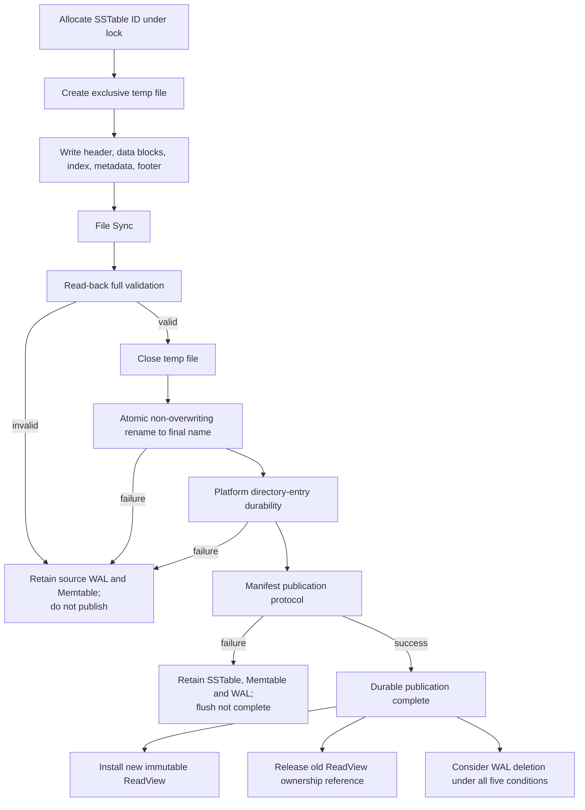

# SSTable Design

> **Status:** Finalized v1 on-disk format and publication protocol. The byte layout
> below is the implementation contract. Compaction, level management, Bloom
> filters, prefix compression and block caching are out of scope for Phase 1.
>
> **Initial platform:** Windows 10/11 local NTFS through the filesystem
> abstraction. Directory-entry durability is a required platform operation that
> must be validated; see
> [RECOVERY_AND_DURABILITY.md](RECOVERY_AND_DURABILITY.md) §9.

## 1. Purpose and authority

An SSTable is an immutable, sorted key-value file produced from one immutable,
non-empty Memtable generation. It is the persistent representation used by the
read path after a flush.

An SSTable file is not automatically part of the database. It becomes
**published** only when the authoritative Manifest durably references it.
Publication is never represented by a flag inside the SSTable.

## 2. File layout

All integers are little-endian. There is no padding or alignment between entries
or blocks. Phase 1 uses CRC32C Castagnoli for every checksum.

```text
+-------------------------------+
| Header (36 bytes)             |  offset 0
+-------------------------------+
| Data block 0 (framed)         |  offset 36
| Data block 1 (framed)         |
| ...                           |
+-------------------------------+
| Sparse index block (framed)   |
+-------------------------------+
| Metadata block (framed)       |
+-------------------------------+
| Footer (40 bytes)             |  last 40 bytes of file
+-------------------------------+
```

A **framed block** is:

| Field | Size | Meaning |
|---|---:|---|
| `payload_len` | 4 | Payload length in bytes, excluding this field and the CRC |
| `payload` | `payload_len` | Block contents |
| `crc32c` | 4 | CRC32C over the 4-byte `payload_len` field and the payload |

`block_total_len = 4 + payload_len + 4`.

The file contains at least one data block. Data blocks, the sparse index block
and the metadata block are all framed. The footer is not framed.

## 3. Header

The header is exactly 36 bytes:

| Offset | Size | Field | Value / meaning |
|---:|---:|---|---|
| 0 | 4 | Magic | ASCII `RKST` |
| 4 | 2 | Format version | `1` |
| 6 | 2 | Flags | `0` |
| 8 | 8 | SSTable ID | Stable ID, greater than zero |
| 16 | 8 | Source GenerationID | WAL segment ID that produced the table |
| 24 | 8 | Source WAL segment ID | Must equal Source GenerationID in v1 |
| 32 | 4 | Header CRC32C | CRC32C over bytes 0–31 |

Rules:

- Unknown versions, nonzero flags and checksum failures are fatal.
- The header SSTable ID must match the filename and Manifest metadata.
- `source_generation_id` must equal `source_wal_segment_id` and be greater than
  zero in v1.
- The header is never modified after publication.

## 4. Data entries

Each entry has this exact encoding:

| Offset | Size | Field |
|---:|---:|---|
| 0 | 4 | `key_len` |
| 4 | 4 | `value_len` |
| 8 | 8 | `sequence` |
| 16 | 1 | `entry_type` |
| 17 | `key_len` | User key bytes |
| 17 + `key_len` | `value_len` | Value bytes |

`entry_size = 17 + key_len + value_len`.

Rules:

- `key_len` is in `[1, 1,048,576]` (1 MiB).
- `sequence` is greater than zero.
- Type `1` is Put. A Put may have an empty value.
- Type `2` is Delete. `value_len` must be zero.
- No other types are valid in v1.
- The entry must fit completely inside its data block payload.
- There is no per-entry checksum; the block CRC covers all entries.
- Phase 1 builders only write entries derived from valid WAL records, so the WAL
  record-size limits also bound the source data.

Ordering:

- User keys are compared lexicographically by raw bytes, ascending.
- For one user key, sequence numbers are descending, so the newest version is
  first.
- All versions of one user key must be in the same data block.
- Data blocks are strictly increasing by first key. The last user key of block
  `N` is less than the first user key of block `N + 1`.
- A sequence number appears at most once in a generation and therefore at most
  once in its SSTable.

Tombstones are retained. A Delete may never be discarded merely because a value
exists in an older table.

## 5. Data block construction

- Target data-block payload size is **4 KiB (4,096 bytes)**.
- Entries are added whole. An entry is never split across blocks.
- If adding the next entry would exceed the target and the current block is not
  empty, the current block is closed and a new block starts.
- If one entry alone exceeds the target, it occupies its own block.
- A data block payload contains at least one complete entry.
- The index and metadata identify every block and its exact byte range.

The 4 KiB value is a target, not a hard maximum or a padding rule.

## 6. Sparse index block

The sparse index is a framed block whose payload is a sequence of index entries:

| Offset | Size | Field |
|---:|---:|---|
| 0 | 4 | `first_key_len` |
| 4 | 8 | `block_offset` |
| 12 | 4 | `block_total_len` |
| 16 | `first_key_len` | First user key of the block |

`index_entry_size = 16 + first_key_len`.

Rules:

- There is exactly one index entry per data block, in data-block order.
- `block_offset` is the absolute file offset of the data block's `payload_len`
  field.
- `block_total_len` is `4 + payload_len + 4`.
- `first_key` is the first user key in that data block.
- `first_key_len` is in `[1, 1,048,576]`.
- Index entries are strictly increasing by `first_key`.
- The index block has its own frame CRC.

Lookup finds the greatest index `first_key` less than or equal to the target key
and scans that data block. Because all versions of a key are kept in one block,
at most one block is required for a point lookup.

## 7. Metadata block

The metadata payload begins with a fixed 68-byte prefix:

| Offset | Size | Field |
|---:|---:|---|
| 0 | 2 | Metadata version (`1`) |
| 2 | 2 | Flags (`0`) |
| 4 | 8 | SSTable ID |
| 12 | 8 | Source GenerationID |
| 20 | 8 | Source WAL segment ID |
| 28 | 8 | Entry count, including tombstones |
| 36 | 4 | Data block count |
| 40 | 4 | Index entry count |
| 44 | 8 | Smallest sequence |
| 52 | 8 | Largest sequence |
| 60 | 4 | `smallest_key_len` |
| 64 | 4 | `largest_key_len` |
| 68 | `smallest_key_len` | Smallest user key bytes |
| 68 + `smallest_key_len` | `largest_key_len` | Largest user key bytes |

The fixed prefix is exactly 68 bytes. The metadata block is framed, so its
framed length is `4 + 68 + smallest_key_len + largest_key_len + 4`.

Validation rules:

- Metadata version is `1`; flags are zero.
- SSTable ID and source identities match the header and filename.
- `source_generation_id == source_wal_segment_id`.
- `entry_count > 0` and `data_block_count > 0`.
- `index_entry_count == data_block_count`.
- `smallest_sequence <= largest_sequence`.
- Key lengths are in `[1, 1,048,576]`.
- `smallest_key <= largest_key` by raw-byte comparison.
- Entry count, block count, key bounds and sequence bounds match the complete
  scan of the data blocks.

## 8. Footer

The footer is exactly 40 bytes and is the last 40 bytes of the file:

| Offset | Size | Field | Value / meaning |
|---:|---:|---|---|
| 0 | 4 | Magic | ASCII `RKFT` |
| 4 | 2 | Format version | `1` |
| 6 | 2 | Flags | `0` |
| 8 | 8 | Index offset | Absolute offset of index frame |
| 16 | 4 | Index length | Total framed length of index block |
| 20 | 8 | Metadata offset | Absolute offset of metadata frame |
| 28 | 4 | Metadata length | Total framed length of metadata block |
| 32 | 4 | Reserved | `0` |
| 36 | 4 | Footer CRC32C | CRC32C over bytes 0–35 |

Layout validation:

```text
index_offset                    = end of last data block
index_offset + index_length     = metadata_offset
metadata_offset + metadata_length = file_size - 40
footer_offset + 40              = file_size
```

There are no gaps or overlapping regions. The footer CRC covers the first 36
footer bytes. Any mismatch is fatal.

## 9. Whole-file checksum

The Manifest's `checksum` field is the CRC32C of the **entire SSTable file**,
from the first header byte through the last footer byte. It is not stored inside
the SSTable.

- The builder computes it over the bytes written.
- Creation-time validation recomputes it from the actual file.
- Recovery recomputes it and compares it with the Manifest value.
- A missing or mismatched whole-file checksum makes the referenced SSTable
  invalid.

The header, every block and the footer also carry localized CRC32C checksums.

## 10. Identity

- **SSTable ID** is independent of the generation identity.
- The header, metadata, filename and Manifest must all agree on the same SSTable
  ID.
- The header and metadata record both `source_generation_id` and
  `source_wal_segment_id`. In v1 these are equal.
- The Manifest records the source WAL segment ID.
- In Phase 1 every flushed SSTable has `level = 0`; compaction and higher levels
  are future work.
- IDs are never reused. Allocation is defined in
  [MANIFEST_DESIGN.md](MANIFEST_DESIGN.md) §7.

## 11. Filenames and temporary files

Phase 1 uses the SSTable directory:

```text
<db>/sst/
```

Final filename:

```text
sstable-%06d.sst
```

Temporary filename:

```text
sstable-%06d.sst.tmp
```

SSTable IDs are limited to `1..999,999` in v1. The numeric field is exactly six
zero-padded decimal digits. IDs outside that range or malformed names are not
valid SSTable artifacts.

- A temporary file is never published and is ignored by the read path.
- A temporary name still establishes an observed ID for allocation purposes.
- A final file not referenced by the selected Manifest is an orphan.
- Orphans are never adopted merely because they are valid.

## 12. Durable creation protocol



Numbered contract:

1. Allocate an SSTable ID under synchronization. Never reuse an observed ID.
2. Create `sstable-%06d.sst.tmp` exclusively. Do not overwrite an existing file.
3. Write the complete header, sorted data blocks, sparse index, metadata and
   footer. Compute all checksums and the whole-file checksum.
4. Sync the temporary file.
5. Validate the complete file from its actual bytes: header, footer, metadata,
   index, every data block, every block CRC, whole-file checksum, identities,
   counts, ordering and bounds.
6. Close the temporary file.
7. Atomically rename it to `sstable-%06d.sst` using a non-overwriting
   same-volume rename. If the target exists, fail; never replace it.
8. Perform the platform directory-entry durability operation for the SSTable
   directory.
9. Only after step 8 succeeds, publish the SSTable through the Manifest.
10. Only after durable Manifest publication may the flush be considered
    complete, the new immutable ReadView be installed and the old ReadView’s
    ownership reference be released. Reclamation occurs only when that view’s
    reference count reaches zero.
11. WAL deletion remains subject to all five conditions in
    [WAL_DESIGN.md](WAL_DESIGN.md) §8.

A crash after rename but before directory durability leaves a final-named file
whose durability is uncertain. It must not be treated as durably created and
must not be referenced by a Manifest.

If Manifest publication fails after step 8, retain the SSTable, immutable
Memtable and WAL. The flush is incomplete. Retry or reconcile safely during
recovery.

## 13. Validation

### 13.1 Creation-time full validation

Creation-time validation reads the file contents and verifies:

- file size and footer position;
- header magic, version, flags and header CRC;
- footer magic, version, flags, reserved field and footer CRC;
- footer offsets and lengths, with no gaps or overlaps;
- metadata frame CRC and every metadata field;
- index frame CRC, entry count and first-key ordering;
- every data block frame CRC;
- every entry's lengths, type, sequence and bounds;
- ordering within and across blocks;
- entry count, block count, key bounds and sequence bounds;
- source generation and WAL identity;
- whole-file CRC32C.

No SSTable may be published unless every check passes.

### 13.2 Recovery-time full validation

Every Manifest-referenced SSTable is validated completely during recovery:

- file exists and its size matches the Manifest;
- filename and filename ID match the Manifest and header;
- header, footer, metadata and index are valid;
- every data block is read and every block CRC is verified;
- every entry is structurally valid and correctly ordered;
- entry count, key bounds and sequence bounds match the metadata and Manifest;
- source generation equals source WAL segment ID in v1;
- source WAL segment ID matches the Manifest;
- the whole-file CRC32C matches the Manifest `checksum`.

Any missing file, structural inconsistency, metadata mismatch or checksum
failure makes the referencing Manifest unusable. Recovery falls back to an
older Manifest or reconstruction; it never skips the reference silently.

Recovery also cross-checks the Manifest set: no two SSTables may claim the same
source generation, and their sequence ranges must form a contiguous published
prefix. See [MANIFEST_DESIGN.md](MANIFEST_DESIGN.md) §8.

## 14. Orphans, temporary files and cleanup

- A `.sst.tmp` file is unpublished and never visible to readers.
- A final `.sst` file not referenced by any retained Manifest is an orphan.
- An orphan's ID remains consumed even if its contents are invalid.
- A valid orphan is not automatically adopted. Adoption is allowed only under
  the reconstruction predicate in
  [RECOVERY_AND_DURABILITY.md](RECOVERY_AND_DURABILITY.md) §8.
- An orphan may be deleted only when it is not referenced by any retained
  Manifest and its source WAL or other retained data proves that deleting it
  cannot lose acknowledged data.
- If source data is insufficient to prove safety, retain the file and fail
  startup rather than guessing.
- A temporary file may be cleaned only when its ID and any source data have been
  accounted for and no recovery path requires it.

Cleanup must follow the Manifest cleanup ordering. Deleting an SSTable file
requires the platform directory-entry durability operation for the deletion.

## 15. Failure behavior

| Failure | Required behavior |
|---|---|
| Temp creation fails | No publication; retain Memtable and WAL; report flush failure. |
| Write or file Sync fails | Do not validate as success; retain source; temp may remain; retry safely. |
| Validation fails | Do not rename or publish; retain source; retain invalid temp for diagnosis. |
| Rename fails or target exists | Never overwrite; retain temp/orphan; report flush failure. |
| Directory durability fails | Do not publish through Manifest; retain the file as an unconfirmed orphan. |
| Manifest publication fails | Retain SSTable, Memtable and WAL; flush incomplete; retry/reconcile. |
| SSTable ID exhausted or conflicting | Never wrap or reuse; fail the flush safely and preserve files. |
| Referenced SSTable missing/corrupt | Manifest unusable; fallback; if no valid state, fail startup preserving files. |

## 16. Invariants

1. SSTables are immutable after publication.
2. A valid SSTable is not automatically published.
3. Manifest publication determines membership.
4. No `published` flag exists in the SSTable.
5. The v1 byte layout, field widths, checksums and footer are exact.
6. All versions of one user key are in one data block.
7. Tombstones are retained and cannot allow an older value to reappear.
8. The whole-file CRC32C in the Manifest covers the entire file.
9. Every referenced SSTable is fully validated during recovery.
10. A Manifest is never published before the SSTable file is synced, fully
    validated, renamed and directory-durable.
11. No SSTable file is ever overwritten.
12. SSTable IDs are never reused.
13. An orphan is never adopted without provable source evidence.
14. A referenced SSTable is never silently ignored.
15. An SSTable referenced by any retained Manifest is never deleted.
16. An empty Memtable generation produces no SSTable.
17. A published ReadView owns the SSTable metadata and file references it
    captured; reclamation occurs only when its reference count reaches zero.

## 17. Related documents

- [SYSTEM_ARCHITECTURE.md](SYSTEM_ARCHITECTURE.md)
- [MEMTABLE_DESIGN.md](MEMTABLE_DESIGN.md)
- [MANIFEST_DESIGN.md](MANIFEST_DESIGN.md)
- [RECOVERY_AND_DURABILITY.md](RECOVERY_AND_DURABILITY.md)
- [FAILURE_SCENARIOS.md](FAILURE_SCENARIOS.md)
- [DECISIONS.md](DECISIONS.md)
