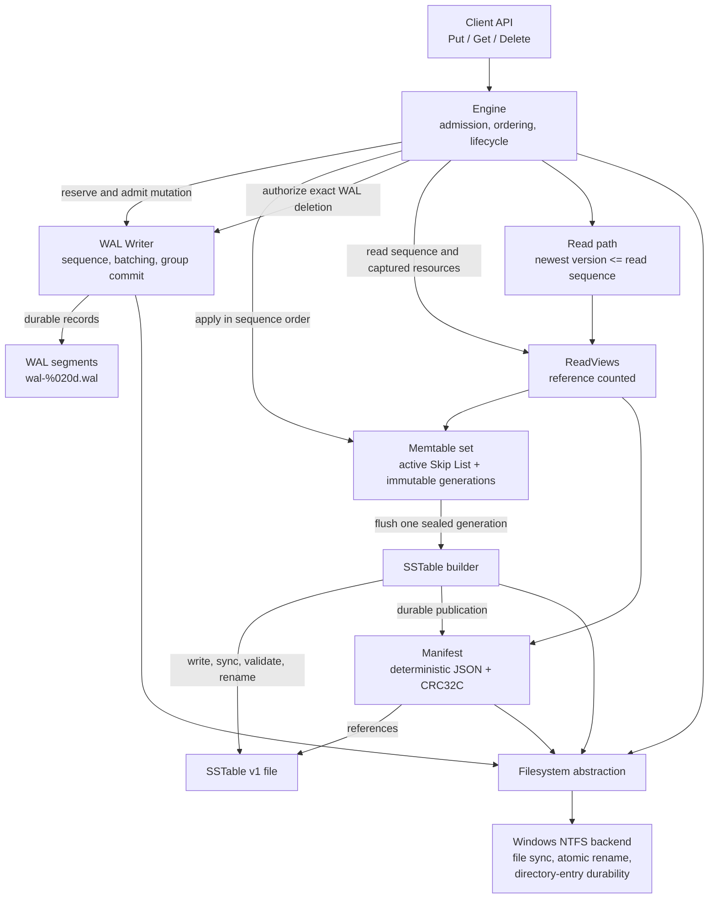
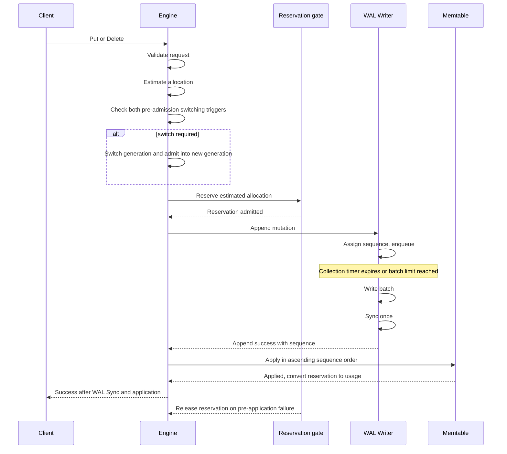
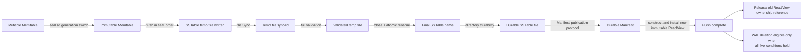
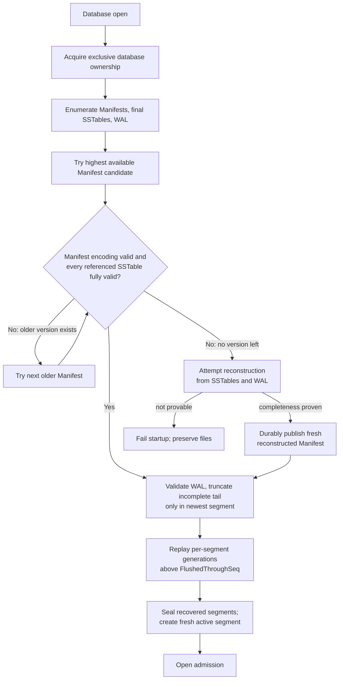

# System Architecture

> **Status:** Finalized Phase 1 architecture. Every statement in this document is
> a finalized decision unless it is explicitly identified as a remaining
> implementation validation requirement. See [DECISIONS.md](DECISIONS.md) and
> [OPEN_QUESTIONS.md](OPEN_QUESTIONS.md).
>
> **Initial platform:** Windows 10/11 with local NTFS storage, implemented behind
> a filesystem abstraction.

## 1. Purpose

This document defines the Phase 1 storage-engine architecture: which component
owns each responsibility, how a write becomes durable and visible, how a sealed
Memtable becomes a published SSTable, how reads obtain a consistent view, and
which invariants must never be violated. Exact formats and protocols live in the
component documents.

Phase 1 is single-node. The storage engine is intended to become the local state
machine behind a future Raft implementation, but this document does not define
Raft behavior, replication, leadership or cluster membership.

## 2. Overall architecture



The diagram shows logical dependencies, not processes. The WAL Writer and the
Engine are not separate processes in Phase 1. The WAL Writer is a dedicated owner
of WAL file appends and syncs; the Engine coordinates everything else. All file
operations pass through the filesystem abstraction so the storage logic is not
tied to Windows APIs.

## 3. Component ownership

### 3.1 WAL

The WAL is responsible for:

- append-only WAL segment files;
- record framing and CRC32C checksums;
- sequence assignment;
- write batching and group commit;
- file synchronization;
- segment creation and rotation execution;
- recovery scanning and incomplete-tail handling;
- physical deletion of explicitly authorized obsolete segments.

The WAL does **not** decide whether data is safe to delete. It does not inspect
SSTables or the Manifest to second-guess the Engine. Its deletion validation is
limited to checking the authorization against its own sealed-segment metadata.

The WAL does not autonomously rotate a segment. Automatic generation switching
has exactly two triggers, both checked by the Engine before write admission: a
projected Memtable threshold crossing, or appending the complete encoded record
exceeding the configured WAL segment-size limit. The WAL executes the resulting
segment creation and sealing using the filesystem abstraction. An empty Memtable,
startup, shutdown, flush completion and timers do not trigger rotation.

### 3.2 Engine

The Engine is responsible for:

- validating requests;
- write admission and ordering;
- checking both pre-admission generation-switching triggers;
- coordinating memory reservations with the active Memtable;
- applying records to the Memtable in sequence order;
- client acknowledgement;
- managing Memtable generations and switching;
- coordinating flushes and durable publication;
- publishing immutable ReadViews for readers;
- deciding when WAL deletion is safe;
- authorizing deletion of the exact generation-owned segment;
- database lifecycle and caller-context shutdown.

The Engine owns the authoritative runtime generation mapping:

```text
GenerationID 1 = WAL segment 1 -> Memtable generation 1 -> SSTable (independent ID)
GenerationID 2 = WAL segment 2 -> Memtable generation 2 -> SSTable (independent ID)
```

The generation identity is not a separate durable counter or registry. It is the
WAL segment ID. The Engine must nevertheless preserve the mapping through flush,
SSTable creation, Manifest publication and WAL deletion authorization. The WAL
can verify that an authorization matches its own segment metadata, but it cannot
detect a logically incorrect yet internally consistent authorization.

The Engine also owns the client-acknowledgement gate and the ReadView
publication coordinator. ReadView acquisition uses a short-held `sync.RWMutex`
and ReadView-level reference counting; readers reference the published ReadView,
not individual Memtables or SSTables. WAL append success is not client success.

### 3.3 Memtable

The Memtable is responsible for:

- in-memory key-value storage using a **Skip List**;
- ordered internal keys;
- applying writes in ascending sequence order;
- supporting concurrent readers while the active Memtable is mutable;
- incremental estimated memory reservation accounting;
- becoming immutable when its generation is sealed;
- being retained by the published ReadView that captured it;
- being reclaimed only when that ReadView’s reference count reaches zero;
- flushing in sorted key order into exactly one SSTable per non-empty
  generation, with no SSTable for an empty generation.

The internal key is ordered by user key ascending, then sequence number
descending so the newest version of a key is encountered first. Entries carry
their sequence, entry type and value; deletes are tombstones with no value.
Tombstones are retained until they are represented in a published SSTable and
may never be dropped in a way that would let an older value reappear.

The active Memtable supports concurrent reads and ordered application. The
concrete synchronization primitives are an implementation choice, but they must
provide the semantics defined in
[CONCURRENCY_AND_LIFECYCLE.md](CONCURRENCY_AND_LIFECYCLE.md).

### 3.4 SSTable

The SSTable is responsible for:

- immutable sorted key-value storage on disk;
- a fixed-size header, sorted data blocks, sparse block index, metadata block and
  fixed-size footer;
- CRC32C checksums for the header, every framed block and the footer;
- recording its own SSTable ID, source GenerationID and source WAL segment ID;
- full structural and integrity validation during creation and recovery.

The v1 format is exact and block-based:

- little-endian encoding;
- 4 KiB target data blocks;
- sparse index entries containing the first key and file offset of each block;
- no compression, Bloom filters, prefix compression or block caching;
- one whole-file CRC32C value recorded in the Manifest for end-to-end integrity.

A valid SSTable file is not automatically a published SSTable. The exact layout
is defined in [SSTABLE_DESIGN.md](SSTABLE_DESIGN.md).

### 3.5 Manifest

The Manifest is responsible for:

- authoritative metadata about published SSTables;
- database and Manifest format versions;
- `FlushedThroughSeq`;
- per-SSTable metadata, including source WAL segment ID;
- `NextSSTableID`.

The Manifest contains no actual key-value records. It is encoded as deterministic
JSON with a CRC32C trailer. Publication uses a complete snapshot, temporary file,
file sync, atomic rename and the platform directory-entry durability operation.
The Manifest is authoritative only after that publication protocol completes and
reports success.

Recovery checks available versions in descending version-number order and selects
the highest-numbered **valid** Manifest. Validity includes full validation of
every referenced SSTable. A Manifest whose pre-crash directory durability step
was not observed may still survive and be selected if it and all referenced
SSTables are valid. That selection proves only that the surviving files form a
consistent state now; it does not retroactively prove that publication had been
acknowledged before the crash. Filename ordering alone is never proof of durable
publication.

The Manifest may temporarily have a fourth version during crash-safe
create-before-delete publication. The final retention target is three committed
versions after cleanup. This resolves the former C-001 conflict. See
[MANIFEST_DESIGN.md](MANIFEST_DESIGN.md) and [DECISIONS.md](DECISIONS.md).

### 3.6 Filesystem abstraction

The storage engine must not call platform file APIs directly. A filesystem
abstraction separates the storage engine from platform operations and covers at
least:

- temporary file creation;
- file writing;
- file `Sync`/flush;
- atomic same-volume rename without overwriting an existing target;
- directory-entry durability handling;
- file deletion;
- directory durability handling after deletion where supported.

Phase 1 provides a Windows 10/11 NTFS backend. The same logical publication
protocols apply to WAL, SSTable and Manifest files on every backend. The
platform-specific mechanism that implements directory-entry durability is
distinct from the logical protocol and is an explicit implementation validation
requirement; see [RECOVERY_AND_DURABILITY.md](RECOVERY_AND_DURABILITY.md).

## 4. Data flow

### 4.1 Write path and acknowledgement

The WAL sequence is authoritative. The Engine must never apply records to a
Memtable in arbitrary completion order.



Key points:

- Before admission, the Engine checks exactly two automatic switching triggers:
  the projected Memtable usage reaching the configured threshold, or appending
  the complete encoded WAL record exceeding the configured segment-size limit.
  If either triggers, the waiting write is admitted into the new generation.
  Emptiness, startup, shutdown, flush completion and timers do not trigger a
  switch.
- A request is admitted into the current generation before the generation gate
  closes, or it waits for the next generation.
- The memory reservation is obtained before WAL admission. It covers the key,
  value, entry/object overhead, Skip List node overhead and associated
  allocations, plus a conservative safety margin.
- A write that cannot fit within the hard Memtable limit or within a fresh
  configured WAL segment is rejected explicitly rather than over-admitted.
- The WAL assigns a sequence only after the request is accepted for enqueue.
- All requests in a WAL batch complete only after the batch’s single successful
  `Sync`.
- Requests arriving during the current write or `Sync` belong to a later batch.
- The Engine applies records in ascending sequence order. A higher sequence may
  not be applied while a lower admitted sequence is unapplied.
- Client success is returned only after WAL `Sync` and successful Memtable
  application.
- Context cancellation may prevent admission before enqueue. Once admitted, the
  write cannot be cancelled halfway through WAL processing.

### 4.2 Read path and ReadViews

Reads do not consult the WAL. A `Get` acquires a published ReadView. Acquisition
takes the short-held `RLock`, captures the current ReadView, increments the
ReadView’s reference count while still holding `RLock`, then releases `RLock`.
The entire read uses that captured view and releases its reference exactly once on
completion, whether the key is found, not found, or the read fails.

The ReadView captures:

- one `read_sequence` equal to the last sequence applied to a Memtable;
- one consistent active/immutable Memtable set;
- one immutable published-SSTable metadata view.

Lookup order is:

1. active Memtable;
2. immutable Memtables, newest to oldest;
3. published SSTables, newest to oldest, respecting level order.

Within that order, the read returns the newest entry for the key whose sequence
is at or below `read_sequence`. A tombstone at that version means “not found.”
Entries with a higher sequence are ignored, even if they are visible in the
currently mutable Memtable.

This is a stable point-in-time ReadView built from the sequence numbers already
present in the LSM structure. It is not a separate snapshot subsystem: there are
no persistent snapshots, no extra version store and no copy of the Memtable.

Manifest publication durably installs the new SSTable metadata. The Engine then
constructs a complete immutable ReadView and installs it as the current published
view under the publication write lock, and releases the old view’s ownership
reference. Existing readers finish with their captured view; a reader cannot
observe an inconsistent mixture of old Memtables and new SSTable metadata. The
protocol is specified in
[CONCURRENCY_AND_LIFECYCLE.md](CONCURRENCY_AND_LIFECYCLE.md) §6.

### 4.3 Flush and publication path



A valid SSTable file is not published just because it exists. Publication requires
the durable Manifest update. Only after durable publication may the Engine:

- construct and install the new immutable ReadView;
- consider the flush complete;
- release the old ReadView’s ownership reference;
- consider WAL deletion, subject to all five deletion conditions.

Readers that already hold ReadView references may keep using the immutable
Memtable after the Engine releases its ownership. The Memtable and its supporting
file resources are reclaimed only when the ReadView reference count reaches zero.

Flush publication is serialized in generation/seal order. A later generation
must not publish an SSTable before an older unflushed generation, because that
would break the contiguous meaning of `FlushedThroughSeq` and complicate
fallback. The old immutable Memtable still flushes independently of new writes;
independence is from the new generation’s write path, not permission to reorder
publication.

### 4.4 Recovery path



The diagram is logical, not a claim that validation can be deferred. A missing or
corrupted Manifest-referenced SSTable must never be silently ignored. Every
referenced SSTable is fully validated before its Manifest is considered usable.
The reconstruction predicate is conservative and is defined in
[RECOVERY_AND_DURABILITY.md](RECOVERY_AND_DURABILITY.md).

## 5. Generation model

The core Phase 1 relationship is:

```text
one WAL segment -> one Memtable generation -> one SSTable publication
```

Example:

```text
WAL segment 1 (GenerationID 1) -> Memtable-1 -> SSTable-17
WAL segment 2 (GenerationID 2) -> Memtable-2 -> SSTable-18
```

Identity rules:

- **GenerationID equals the WAL segment ID.**
- Do not introduce a separate durable generation counter or generation registry.
- The WAL segment ID is the durable generation identity carried through the
  process.
- **SSTable IDs are independent** and allocated from `NextSSTableID` plus a
  startup filename scan. They are not generation IDs.
- Each SSTable header records both its `source_generation_id` and
  `source_wal_segment_id`. In v1 these values must be equal.
- Manifest per-SSTable metadata records the source WAL segment ID.
- Recovery cross-checks the SSTable header, Manifest metadata and WAL segment
  before authorizing deletion or accepting a generation mapping.
- The Memtable identity is runtime state. It is not separately durable.

The one-to-one rule applies to normal operation and to recovery. A recovered WAL
segment with records above the selected watermark becomes one recovery
generation, and its records flush into one SSTable publication. A segment whose
complete range is at or below the watermark is already represented and is not
replayed. A segment whose range straddles the watermark is an inconsistent
history and fails recovery.

WAL rotation and Memtable switching happen together. Automatic switching has
exactly two triggers, both checked before write admission: the projected Memtable
threshold and the complete next encoded WAL record exceeding the segment-size
limit. The full protocol is in [MEMTABLE_DESIGN.md](MEMTABLE_DESIGN.md) and
[CONCURRENCY_AND_LIFECYCLE.md](CONCURRENCY_AND_LIFECYCLE.md) §5. An empty
generation remains valid; it produces no SSTable and adds no WAL deletion rule.

## 6. Durable publication

A valid file is not a durable publication. The required boundaries are:

### WAL

A WAL record is durable when its containing batch has completed a successful
file `Sync` and the WAL Writer has returned append success. The record has merely
been written if the `Sync` has not completed. A failed `Sync` leaves durability
uncertain.

### SSTable

An SSTable is durably created only after:

1. the complete file has been written to a temporary file;
2. the temporary file has been synced;
3. the complete file has been fully validated;
4. the temporary file is closed;
5. the file is atomically renamed to its final name without overwriting an
   existing SSTable;
6. the platform directory-entry durability operation completes.

Only then may the Manifest reference the file. A crash after rename but before
directory durability leaves an orphan that must not be treated as durably
published.

### Manifest

Manifest publication follows the same complete-snapshot protocol:

1. generate the complete updated Manifest payload;
2. append the CRC32C trailer;
3. write the temporary file;
4. sync the temporary file;
5. atomically rename it to the new authoritative versioned filename;
6. perform the platform directory-entry durability operation;
7. only then report successful durable publication.

A crash before the rename leaves the old Manifest authoritative. A crash after
the rename but before directory durability leaves publication durability
uncertain; recovery must reconcile it through the hierarchy. The directory
durability step is the publication-success boundary. Filename ordering alone does
not prove it.

### Publication versus acknowledgement

Publication and client acknowledgement are different events:

- A **client write acknowledgement** means the record’s WAL batch completed a
  successful `Sync` and the record was successfully applied to the Memtable.
- An **SSTable publication acknowledgement** means the Manifest publication
  protocol completed durably. It concerns authoritative metadata membership, not
  a client response.
- A flush may publish records whose client writes were acknowledged earlier, and
  it may also publish a synced but unacknowledged record. Neither case changes
  the rule that the client was acknowledged only after WAL `Sync` and Memtable
  application.

## 7. Ownership boundaries and interactions

| Action | Owner | Must not be done by |
|---|---|---|
| Assign WAL sequence | WAL Writer | Engine, Memtable, SSTable builder |
| Write and sync WAL batch | WAL Writer | Any other goroutine |
| Estimate and reserve Memtable memory | Engine admission path | WAL Writer, flush builder |
| Apply writes to Memtable | Engine apply path | WAL Writer, flush builder |
| Seal a generation | Engine switch coordinator | WAL Writer independently |
| Create new WAL segment | WAL Writer under Engine request | Engine directly |
| Build SSTable | Flush component under Engine coordination | WAL Writer |
| Rename and make SSTable durable | Flush component via filesystem abstraction | Manifest publisher alone |
| Publish SSTable | Manifest publication path | SSTable builder alone |
| Install ReadView | Engine ReadView publication coordinator | Manifest, SSTable builder |
| Authorize WAL deletion | Engine | WAL Writer on its own judgment |
| Physically delete WAL | WAL Writer via filesystem abstraction | Engine directly |
| Reclaim view-owned resources | ReadView owner at reference count zero | Readers, WAL Writer |
| Decide read visibility | Engine/read path | Manifest |
| Directory durability operation | Filesystem backend | Component-specific ad hoc code |

The WAL Writer and Engine cooperate through a narrow append interface. The exact
Go interface is not part of this documentation; it must preserve the ownership
rules above.

## 8. Invariants

These invariants are non-negotiable. Every component document must agree with
them.

1. **Acknowledged writes are durable and applied.** Successful client
   acknowledgement requires a successful WAL `Sync` and successful Memtable
   application.
2. **WAL sequence order is authoritative.** No component may reorder records.
3. **Memtable application follows ascending sequence order.** Completion order is
   never application order.
4. **One WAL segment belongs to exactly one Memtable generation.**
5. **One non-empty generation produces exactly one SSTable publication.** Normal
   flush must not split one generation’s records across multiple SSTables. An
   empty generation remains valid and produces no SSTable.
6. **GenerationID is the WAL segment ID.** There is no separate durable
   generation counter or registry.
7. **SSTable IDs are independent of generation IDs.** Each SSTable records its
   source GenerationID and source WAL segment ID.
8. **A generation cannot be sealed until all admitted writes finish.** Closing
   the admission gate does not cancel already-admitted writes.
9. **Capacity reservation protects already-admitted writes.** The Memtable must
   never exceed its hard maximum.
10. **ReadViews own their captured resources.** The published ReadView holds an
    ownership reference; readers reference the ReadView, not individual Memtables
    or SSTables. Reclamation occurs only when the ReadView reference count reaches
    zero.
11. **A ReadView is internally consistent.** It captures one `read_sequence`, one
    consistent active/immutable Memtable set and one published-SSTable metadata
    view; it must never mix old Memtables with an incompatible new view or access
    reclaimed memory.
12. **A read never returns a version newer than its captured sequence.**
13. **The Manifest is authoritative for published SSTables.** A valid SSTable
    file is not published until the Manifest durably references it.
14. **Valid does not mean published.** File validity alone is insufficient for
    read visibility, WAL deletion or Engine ownership release.
15. **WAL deletion requires all five conditions.** Durable SSTable publication,
    sealed segment, oldest retained Manifest watermark coverage, exact
    generation mapping and explicit Engine authorization.
16. **WAL deletion must target the exact generation-owned segment.** Never derive
    the target from “oldest WAL”, next segment number or an assumption about
    ordering.
17. **Retained Manifest fallback must remain recoverable.** Three committed
    Manifest versions are retained after cleanup; a fourth may exist transiently
    during publication and must be tolerated by recovery.
18. **Never delete data needed by any retained fallback Manifest.** This includes
    WAL data and SSTables.
19. **Never silently initialize an empty database when existing database files
    are present but recovery fails.** Fail startup and preserve files for manual
    recovery.
20. **Any WAL Write or Sync error causes fail-stop behavior.** The WAL enters a
    Failed state and normal writes stop until close/reopen and recovery.
21. **Memtable application failure after WAL Sync causes Engine fail-stop
    behavior.** Do not skip the failed sequence or apply later sequences.
22. **The active WAL is never authorized for deletion.**
23. **`FlushedThroughSeq` is monotonic.** It may advance only when every sequence
    at or below it is represented in durably published SSTables.
24. **Durable publication precedes WAL deletion, ReadView installation and
    Engine Memtable release.**
25. **A complete record with a bad checksum is corruption, not an incomplete
    tail.** It must not be silently truncated.
26. **Every Manifest-referenced SSTable is fully validated during recovery.** A
    missing, structurally invalid, checksum-invalid or metadata-mismatched
    referenced SSTable makes that Manifest unusable and triggers fallback.
27. **No orphan SSTable is adopted without trustworthy retained WAL/generation
    evidence.** A valid file alone does not prove committed membership.
28. **No normal writes or reads continue after an Engine fail-stop condition.**
    In-flight reads return an error if failure is detected before completion.
29. **Manifest encoding and checksum are deterministic.** Independent
    implementations must compute the same CRC32C over the same canonical payload
    bytes.
30. **A valid SSTable is never overwritten.** SSTable IDs and final filenames are
    never reused.
31. **Platform durability is not assumed.** An unsupported directory durability
    operation must be reported as an error, never silently treated as success.
32. **Automatic generation switching has exactly two pre-admission triggers:** the
    projected Memtable threshold and the complete next WAL record exceeding the
    configured segment-size limit. Empty Memtables, startup, shutdown, flush
    completion and timers do not trigger switching.
33. **A reader acquires its ReadView reference under `RLock` and releases it
    exactly once on every exit path.**
34. **ReadView publication installs a complete view under the write lock and
    releases the old view’s ownership reference; old resources are never reclaimed
    before the last reader reference is released.**
35. **Shutdown is caller-context controlled.** Context expiry stops only the
    caller’s wait, never forces resource closure, and shutdown continues in the
    background.
36. **An empty generation is valid, produces no SSTable and introduces no special
    WAL deletion rule.**

## 9. Windows platform target

Phase 1 targets Windows 10/11 with local NTFS storage. The logical publication
protocols remain unchanged. The Windows backend must provide:

- file-content `Sync` before rename;
- atomic same-volume rename for the supported operation;
- no overwrite of an existing SSTable;
- a validated mechanism for directory-entry durability;
- deletion and directory durability handling;
- honest error reporting when a required operation is unavailable.

The exact Windows directory-entry durability mechanism is **not** assumed by this
document. It must be established and tested during implementation. Network
drives and filesystems without the required guarantees are outside Phase 1
support. See [RECOVERY_AND_DURABILITY.md](RECOVERY_AND_DURABILITY.md) §9 and
[OPEN_QUESTIONS.md](OPEN_QUESTIONS.md).

The architecture remains portable: a Linux backend can later implement the same
filesystem abstraction without redesigning WAL, Memtable, SSTable or Manifest
logic.

## 10. Future Raft integration boundary

The storage engine is designed to be a deterministic local state machine. Future
Raft integration is expected to supply committed operations to the engine in a
defined order and to use the engine’s durable state for recovery. This document
does not specify:

- the Raft log format;
- whether the Raft log and storage WAL share files;
- term/index metadata in WAL records;
- snapshot transfer;
- leader/follower behavior;
- cluster membership;
- how a replicated state machine identifies duplicate client requests.

The Phase 1 WAL is the storage engine’s local WAL. It is not declared to be the
Raft consensus log. Reusing it as the Raft log would require a separate
architectural review.

## 11. Related documents

- [WAL_DESIGN.md](WAL_DESIGN.md)
- [MEMTABLE_DESIGN.md](MEMTABLE_DESIGN.md)
- [SSTABLE_DESIGN.md](SSTABLE_DESIGN.md)
- [MANIFEST_DESIGN.md](MANIFEST_DESIGN.md)
- [RECOVERY_AND_DURABILITY.md](RECOVERY_AND_DURABILITY.md)
- [CONCURRENCY_AND_LIFECYCLE.md](CONCURRENCY_AND_LIFECYCLE.md)
- [FAILURE_SCENARIOS.md](FAILURE_SCENARIOS.md)
- [OPEN_QUESTIONS.md](OPEN_QUESTIONS.md)
- [DECISIONS.md](DECISIONS.md)
