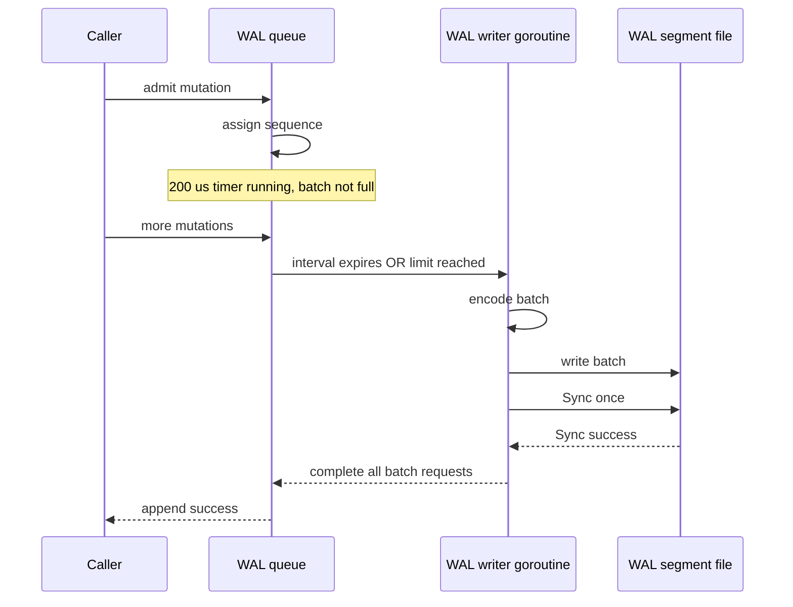
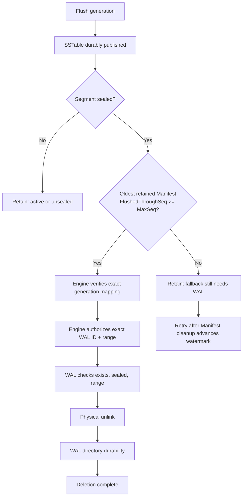

# WAL Design

> **Status:** Finalized. The record format, segment creation, group commit,
> recovery, failure behavior and deletion authorization are approved contracts.
>
> **Initial platform:** Windows 10/11 local NTFS through the filesystem
> abstraction. Directory-entry durability is a required platform operation that
> must be validated, not a Linux `fsync` assumption.

## 1. Purpose and boundaries

The write-ahead log is the storage engine’s append-only durability source. A
mutation is not durable merely because a write call returned. It is durable only
after the containing group batch completes a successful file `Sync`.

The WAL owns:

- append-only segment files;
- record framing and CRC32C checksums;
- sequence assignment;
- batching and group commit;
- file synchronization;
- segment creation and rotation execution;
- recovery scanning;
- incomplete-tail handling;
- physical deletion of explicitly authorized obsolete segments.

The WAL does not own:

- Memtables;
- SSTables;
- Manifest publication;
- the decision that data is safe to delete;
- client acknowledgement. WAL append success is only a prerequisite for the
  Engine’s acknowledgement.

A WAL segment is **active** while it is the one segment accepting records. It is
**sealed** when no more records may be appended. Sealing does not imply that the
segment is safe to delete.

## 2. Segment format

### 2.1 Directory, naming and temporary files

WAL files live in:

```text
<db>/wal/
```

Final filename:

```text
wal-%020d.wal
```

Temporary filename used during creation:

```text
wal-%020d.wal.tmp
```

Segment IDs begin at `1` and increase monotonically. The zero-padded decimal name
sorts lexically in ID order for the supported ID range. Temporary files are not
valid published WAL segments. They may be ignored or cleaned during recovery. A
recovery scanner must never treat a `.tmp` file as a segment.

### 2.2 Segment header

The segment header is exactly 20 bytes. All integers are little-endian.

| Offset | Size | Field |
|---:|---:|---|
| 0 | 4 | Magic `"RKWL"` |
| 4 | 2 | Format version (`1`) |
| 6 | 2 | Flags (`0` in v1) |
| 8 | 8 | Segment ID |
| 16 | 4 | CRC32C Castagnoli over bytes 0–15 |

Rules:

- The segment ID in the header must match the filename.
- Unknown versions are rejected.
- Nonzero flags are rejected.
- Header CRC failure is fatal, except for a provably incomplete newest temporary
  file that never became a valid published segment.
- The version field is part of the format contract. A newer incompatible format
  is not parsed best-effort.

### 2.3 Record layout

The record frame is exactly:

| Offset | Size | Field |
|---:|---:|---|
| 0 | 4 | Total record length, including the length field and checksum |
| 4 | 1 | Record type |
| 5 | 1 | Flags (`0` in v1) |
| 6 | 2 | Reserved (`0` in v1) |
| 8 | 8 | Sequence number |
| 16 | 4 | Key length |
| 20 | 4 | Value length |
| 24 | `keyLen` | Key bytes |
| 24 + `keyLen` | `valueLen` | Value bytes |
| `recordLen - 4` | 4 | CRC32C Castagnoli over all preceding record bytes |

Fixed record overhead is **28 bytes**:

```text
recordLen = 28 + keyLen + valueLen
```

A record is a single frame. Records are never split across WAL segments. Group
commit is a runtime batching concept; there is no on-disk batch header.

**Record types**

| Value | Type |
|---:|---|
| 1 | Put |
| 2 | Delete |

No additional record types are approved.

### 2.4 Validation rules

- Empty keys are rejected.
- Put values may be empty.
- Delete records must have zero value length.
- Flags and reserved fields must be zero.
- Sequence numbers start at `1`.
- Sequence numbers increase exactly by one for admitted records.
- Maximum complete record size: **16 MiB**.
- Maximum key size: **1 MiB**.
- Maximum value size is constrained by the complete record limit:
  `16 MiB - 28 - keyLen`.
- No per-record magic.
- Unknown versions, record types, flags or reserved values are rejected.
- Invalid lengths, integer-overflowing length combinations and inconsistent
  `keyLen`/`valueLen`/`recordLen` values are rejected.
- Length arithmetic is validated before any allocation based on the claimed
  record size.

The limits above are part of the v1 format contract. Error taxonomy and
configuration names are implementation details.

### 2.5 Written, synced and acknowledged

These are different states:

- **Written:** the bytes were passed to the operating system. They may still be
  in a cache.
- **Synced:** `Sync` returned success for the containing batch. This is the WAL
  durability boundary.
- **WAL append success:** the batch containing the record was synced and the WAL
  returned success to the Engine.
- **Acknowledged:** the Engine returned success to the client after the record
  was synced **and** applied to the Memtable.

A WAL append success is not a client acknowledgement.

## 3. Sequence assignment and ordering

The WAL Writer is the sole sequence assigner. A mutation receives its sequence
after validation and when it is accepted into the WAL queue, before enqueue.

Consequences:

- queue order, WAL byte order and sequence order are identical;
- a sequence is never assigned to a request rejected before admission;
- a failed WAL batch may leave sequence numbers that never become durable; after
  recovery the next sequence is derived from recovered data and the Manifest
  watermark, so reuse of an unacknowledged, lost sequence is possible;
- no later sequence may be applied before an earlier admitted sequence.

Durable sequence numbers are gap-free. Recovery treats duplicates, decreases and
gaps above `FlushedThroughSeq` as fatal.

## 4. Append and group commit

### 4.1 Admission

`Append` is synchronous from the caller’s perspective. It returns only after the
record’s batch has completed a successful `Sync`. The caller does not control
individual record fsyncs.

The WAL has one dedicated writer goroutine that owns all WAL file writes and
`Sync` calls. Requests enter a bounded queue. When the queue is full, admission is
backpressured.

Context cancellation is permitted before admission. Once a request is admitted
to the WAL queue, it cannot be cancelled halfway through WAL processing. The WAL
must not leave a durable record unaccounted for because a caller disconnected.

Before admission, the Engine evaluates the complete encoded WAL record size. If
appending that record would exceed the active segment’s configured size limit,
the Engine initiates a coordinated generation switch first and admits the waiting
write into the new generation’s WAL. A record that cannot fit within a fresh
configured segment is rejected explicitly; it must not cause repeated switching.
This is one of the exactly two automatic switching triggers in D-081.

### 4.2 Batch collection

A short configurable collection interval allows additional requests to join the
current batch. A batch is drained and written when the first of these occurs:

1. the collection timer expires; or
2. a configured record or byte limit is reached.

Final initial defaults:

| Setting | Default |
|---|---:|
| WAL segment size | 64 MiB |
| Maximum batch records | 1,024 |
| Batch byte target | 1 MiB |
| WAL request queue capacity | 4,096 requests |
| Group commit collection interval | 200 microseconds |

These are initial configurable implementation defaults, not performance
guarantees. Later benchmarking may justify tuning them.

The batch byte value is a collection target, not a per-record cap. A single record
larger than the target forms its own batch and is written whole; it is never
split or rejected solely because it exceeds the batch byte target. The independent
16 MiB maximum record size still applies.



### 4.3 Batch write

- One batch write is followed by one `Sync`.
- All requests in the batch become durably appended only after the successful
  `Sync`.
- Requests arriving during the current write or `Sync` belong to a later batch.
- The WAL does not retry a failed write or `Sync` in place.
- A partial write, write error or sync error is a fail-stop condition.

The WAL Writer must never continue at a later offset after a write or sync
failure, because it cannot know which records became durable.

### 4.4 Client acknowledgement

Group commit completes WAL requests. It does not complete client requests. The
Engine still has to apply each record to the Memtable in sequence order. Only
then may the client receive success. See
[CONCURRENCY_AND_LIFECYCLE.md](CONCURRENCY_AND_LIFECYCLE.md).

## 5. Segment lifecycle and rotation

### 5.1 Creation protocol

Segment creation is finalized as:

1. create a temporary WAL file;
2. write the complete 20-byte segment header;
3. sync the temporary file;
4. atomically rename it to its final `wal-%020d.wal` filename;
5. perform the platform-specific directory-entry durability operation;
6. only then accept writes into that segment.

A temporary file is not a published WAL segment. A crash before the rename can
leave a temporary file; recovery ignores or cleans it. A crash after the rename
but before directory durability leaves the durability of the new directory entry
uncertain. The old segment remains the authoritative durable tail until the new
segment is established by recovery. No acknowledged write depends on an
uncertain directory entry, because writes are accepted only after step 5.

If the rename or directory durability operation fails, the new segment is not
established, no writes are accepted into it, and the WAL reports the creation
failure. A cleanup attempt must not overwrite an existing final segment.

### 5.2 Active and sealed states

- A newly created segment becomes active only after the full creation protocol.
- The active segment is the only segment that accepts appends.
- Sealing occurs as part of a coordinated generation switch.
- A sealed segment is never appended to again.
- Sealing does not authorize deletion.

### 5.3 Rotation is not independent

The WAL never rotates on its own. Automatic generation switching has exactly two
triggers, both checked by the Engine before write admission:

1. the projected Memtable usage reaches or exceeds the configured switching
   threshold; or
2. appending the complete encoded WAL record would exceed the configured segment
   size limit.

The WAL segment-size trigger is therefore a pre-admission check, not an
independent post-write rotation. The protocol is:

```text
complete encoded record would exceed WAL-001's configured limit
-> Engine closes admission before admitting that record
-> admitted writes finish
-> WAL-001 is sealed
-> WAL-002 is created by the approved protocol
-> Memtable-2 becomes active
-> admission reopens
-> the waiting record is admitted into WAL-002
```

An empty Memtable, startup, shutdown, flush completion and timers do not
independently trigger switching. No other automatic rotation condition exists.

The relationship is explained in [MEMTABLE_DESIGN.md](MEMTABLE_DESIGN.md). One
WAL segment belongs to exactly one Memtable generation, and normal flush
produces exactly one SSTable publication for that non-empty generation. An empty
generation produces no SSTable.

### 5.4 Segment IDs

The WAL Writer assigns the next monotonically increasing segment ID when the
Engine requests a new segment. Segment IDs are not reused. At startup, final and
temporary WAL filenames are observed; temporary files are never treated as
published segments. The first fresh active segment ID is one greater than the
maximum of the highest observed final segment ID and any observed temporary
segment ID, or `1` if neither exists. An observed temporary ID is consumed to
avoid a filename collision even though it was never published.

The WAL segment ID is also the durable **GenerationID**. There is no separate
durable generation counter. See
[SYSTEM_ARCHITECTURE.md](SYSTEM_ARCHITECTURE.md) §5.

## 6. Recovery

### 6.1 Inputs

Recovery uses:

- the selected authoritative Manifest;
- its `FlushedThroughSeq`;
- the WAL directory;
- the WAL format version and the source WAL IDs recorded in published SSTable
  metadata.

The selected Manifest is determined by the recovery hierarchy in
[MANIFEST_DESIGN.md](MANIFEST_DESIGN.md).

### 6.2 Procedure

1. Enumerate final WAL segment files matching `wal-%020d.wal`.
2. Ignore temporary files; never treat them as published segments.
3. Validate filenames and segment IDs.
4. Reject duplicate IDs.
5. Sort segments by segment ID.
6. Validate segment headers.
7. Validate record lengths, key/value lengths, flags, types and checksums.
8. Validate sequence ordering.
9. Detect missing required segments and sequence gaps.
10. Replay only records above the selected Manifest’s `FlushedThroughSeq`.
11. Truncate an incomplete final record only when it is in the newest segment.
12. Reject all other corruption.
13. After recovery, seal existing segments and create a fresh active segment
    using the approved creation protocol.
14. The next sequence is one greater than the highest recovered sequence or the
    durable flushed watermark, whichever is greater.

Recovery does not append to a recovered file. This avoids appending after a
truncated tail and makes the active segment boundary unambiguous.

### 6.3 Incomplete final record

Only the newest WAL segment may contain an incomplete tail that recovery may
truncate. Examples:

- fewer than four bytes remain for the record length;
- the record length claims more bytes than physically remain;
- the payload is cut off by EOF;
- the checksum is cut off by EOF.

Recovery truncates the incomplete record at its starting offset and syncs the
truncated file. The truncation is recorded as a recovery fact for diagnostics.

An incomplete record in a sealed or non-newest segment is fatal. Sealed segments
must be complete.

The truncation rule assumes that a successful `Sync` preserved all previously
acknowledged bytes. It is not a repair strategy for arbitrary post-`Sync`
corruption.

### 6.4 Checksum failure and corruption

A complete record with a bad checksum is **fatal corruption**, not an incomplete
tail. It must not be silently truncated.

Corruption in the middle of a segment is fatal. Recovery does not:

- resynchronize by scanning for magic;
- skip corrupt records;
- continue into later records;
- delete the segment;
- initialize an empty database.

Unknown versions, invalid fields, malformed records, sequence duplicates or
decreases, sequence gaps above the watermark, and invalid sealed segments are
also fatal.

### 6.5 Missing segments

A missing segment whose complete sequence range is at or below the selected
Manifest’s `FlushedThroughSeq` may be absent because its data is already
published. This tolerance applies to replaying the selected Manifest state; it
does not authorize cleanup to delete a WAL still needed by a retained older
Manifest. A missing segment that contains any required sequence above the
watermark is fatal unless trustworthy recovery metadata proves the data is
represented elsewhere.

### 6.6 Generation mapping during recovery

The one-WAL-segment / one-generation rule is preserved during recovery:

- A segment whose complete range is at or below `FlushedThroughSeq` is already
  represented. It contributes no replay records.
- A segment whose complete range is above `FlushedThroughSeq` becomes exactly one
  recovery generation. Its records are replayed in sequence order into that
  generation’s recovery Memtable.
- Multiple unflushed segments become multiple recovery generations, in ascending
  segment order. Their sequence ranges must be contiguous and non-overlapping.
- A segment whose complete range straddles `FlushedThroughSeq` is an inconsistent history
  and fails recovery. A generation is either represented as a whole or not
  represented.
- A segment with zero records is a valid empty generation. It has no sequence
  range, contributes no replay records, does not advance `FlushedThroughSeq` and
  produces no SSTable. No empty SSTable is created for it.
- A gap between the watermark and the first replayed sequence, or between
  replayed segments, is fatal.
- Published SSTable metadata may be used to confirm that a missing or present
  segment is represented, but a source WAL ID mismatch is fatal.

Each recovered non-empty generation flushes as one SSTable publication. Recovery
does not merge multiple historical segments into one generation, and it does not
fabricate an empty SSTable for an empty generation.

### 6.7 Recovery result

Recovery must leave enough information for the Engine to know:

- which segments were scanned;
- the last recovered sequence;
- what was truncated;
- which segments were skipped because they were already flushed;
- which recovery generations were created;
- that a fresh active segment was created;
- whether any corruption prevents startup.

The exact Go result structure is not fixed by this documentation.

## 7. Failure handling

### 7.1 Writer states

The WAL Writer has at least these observable states:

| State | Meaning |
|---|---|
| Open | Accepting appends and syncing batches |
| Failed | A write or sync failure occurred; no new writes; terminal until reopen/recovery |
| Closed | No further use |

A failed WAL is not repaired in place.

### 7.2 Write or Sync failure

On any WAL write or `Sync` failure:

- mark the WAL Writer Failed;
- reject new writes;
- fail affected in-flight and queued requests;
- do not retry in place;
- do not truncate or seek and continue;
- do not assume which records became durable;
- require database close/reopen and recovery.

A successful `Sync` is the durability boundary. A failed `Sync` leaves durability
uncertain. The data may be partially present, fully present or absent.

### 7.3 Deletion failure

Failure to delete a WAL segment that has passed all five deletion conditions is a
cleanup failure. The data is already represented in durable SSTables and Manifest
metadata, and no retained fallback requires the segment. The segment is retained
and cleanup is retried later. It is not by itself a WAL writer failure and must
not poison the active writer.

### 7.4 Corruption during recovery

Corruption is not repaired by the WAL Writer. Startup fails for the affected
database state and preserves files for operator recovery. A future repair tool is
not part of Phase 1.

## 8. WAL deletion authorization

### 8.1 Five conditions

A WAL segment becomes eligible for deletion only when **all** of the following
hold:

1. its generation’s SSTable is durably published through the Manifest;
2. the WAL segment is sealed;
3. the oldest retained Manifest has `FlushedThroughSeq >= WAL.MaxSeq`;
4. the Engine’s generation mapping identifies the exact WAL segment; and
5. the Engine explicitly authorizes deletion.

The Engine owns the deletion decision. The WAL performs physical deletion and the
platform directory durability operation.

Do not delete a WAL segment immediately after publication in the newest Manifest
if an older retained Manifest still requires it.

### 8.2 Authorization contents

The authorization identifies:

- WAL segment ID;
- minimum sequence number;
- maximum sequence number.

The WAL performs inexpensive validation:

- the segment exists;
- the segment is sealed;
- its sequence range matches the authorization.

The WAL does **not** repeat SSTable validation, Manifest inspection or full
checksum verification. A logically incorrect but internally consistent
authorization cannot be detected by the WAL. Correct generation mapping is an
Engine invariant.

### 8.3 Physical deletion

After validation, the WAL deletes the specified segment and performs the
platform directory-entry durability operation for the WAL directory. Deletion is
physical only after the Engine has completed durable Manifest publication,
confirmed that the oldest retained Manifest covers the segment’s maximum
sequence, and authorized the exact segment.



### 8.4 Logical deletion versus physical deletion

- **Logical deletion:** the Engine has determined that the WAL’s data is
  represented in durable published SSTables and is no longer needed by any
  retained Manifest.
- **Physical deletion:** the WAL file is unlinked and the WAL directory’s
  deletion is made durable.

A WAL may be logically obsolete while its file still exists because cleanup has
not run or failed. That is safe; extra WAL is retained. The reverse — physical
deletion before logical safety — is forbidden.

## 9. Crash windows

| Window | Possible state | Required behavior |
|---|---|---|
| Temp file created, header not complete | Temp file, no final segment | Ignore/clean temp; no acknowledged write used it |
| Header synced, rename not performed | Valid temp file, old final segment | Ignore/clean temp; no new writes were accepted |
| Rename performed, directory durability not complete | New final name may or may not survive | No writes were accepted before directory durability; recovery ignores an unestablished empty segment |
| Active record write torn | Newest segment has incomplete tail | Truncate only if newest; sync; continue |
| Batch written, sync not completed | Valid-looking unsynced records may survive | Recovery may replay them; they were not acknowledged, so outcome is uncertain |
| Batch synced, Memtable not applied | Complete durable records | Replay into recovery Memtable |
| Segment sealed, new segment creation fails | Old segment durable; new missing/partial | WAL enters Failed; no new writes; recovery uses old durable state |
| WAL deletion crash | Segment may remain or be gone | Manifest publication and old-watermark coverage were durable first; extra segment is safe; never delete before all five conditions |
| WAL deletion directory durability not complete | Deleted name may reappear | Extra segment is safe; cleanup retries; absence is not assumed until durability completes |

## 10. Windows platform requirements

- File contents must be synced with a Windows file-flush operation before rename.
- Rename must be atomic for the supported same-volume operation and must never
  overwrite an existing final segment.
- The directory-entry durability step is platform-specific. It must not be
  implemented by assuming that a Linux-style directory `fsync` is available.
- If the backend cannot perform the required directory durability operation, it
  must return an error. It must not silently report success.
- Network drives and filesystems without the required guarantees are outside the
  Phase 1 support target.
- The exact Windows mechanism and its verification status are recorded in
  [RECOVERY_AND_DURABILITY.md](RECOVERY_AND_DURABILITY.md) §9 and
  [OPEN_QUESTIONS.md](OPEN_QUESTIONS.md).

## 11. Invariants specific to the WAL

1. Only the dedicated WAL Writer writes and syncs WAL files.
2. Sequence assignment and enqueue order are the same.
3. One batch write is followed by one `Sync`.
4. A WAL append is complete only after successful `Sync`.
5. A failed write or `Sync` is not retried in place.
6. The active segment is never deleted.
7. A sealed segment is not deleted until all five deletion conditions hold.
8. The WAL deletion target is the exact generation-owned segment, never the
   “oldest WAL” by heuristic.
9. Incomplete final records may be truncated only in the newest segment.
10. A complete record with a bad checksum is corruption, not tail truncation.
11. Recovery never silently initializes an empty database over existing files.
12. One WAL segment maps to one generation; recovery does not merge historical
    segments into one generation.
13. Header and record checksums use CRC32C Castagnoli with the specified
    coverage.
14. Segment creation and deletion do not report success before the platform
    directory durability step completes.
15. Automatic generation switching has exactly two pre-admission triggers: the
    projected Memtable threshold and the complete next record exceeding the
    configured WAL segment limit. The WAL never rotates independently.
16. An empty generation is valid, produces no SSTable and introduces no special
    WAL deletion rule.
17. A record that cannot fit within a fresh configured segment is rejected; it is
    never split across segments.

## 12. Related documents

- [SYSTEM_ARCHITECTURE.md](SYSTEM_ARCHITECTURE.md)
- [MANIFEST_DESIGN.md](MANIFEST_DESIGN.md)
- [MEMTABLE_DESIGN.md](MEMTABLE_DESIGN.md)
- [RECOVERY_AND_DURABILITY.md](RECOVERY_AND_DURABILITY.md)
- [CONCURRENCY_AND_LIFECYCLE.md](CONCURRENCY_AND_LIFECYCLE.md)
- [FAILURE_SCENARIOS.md](FAILURE_SCENARIOS.md)
- [OPEN_QUESTIONS.md](OPEN_QUESTIONS.md)
- [DECISIONS.md](DECISIONS.md)
